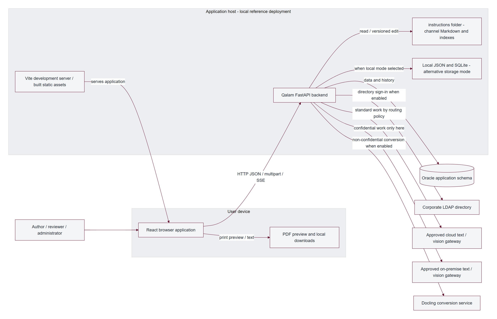
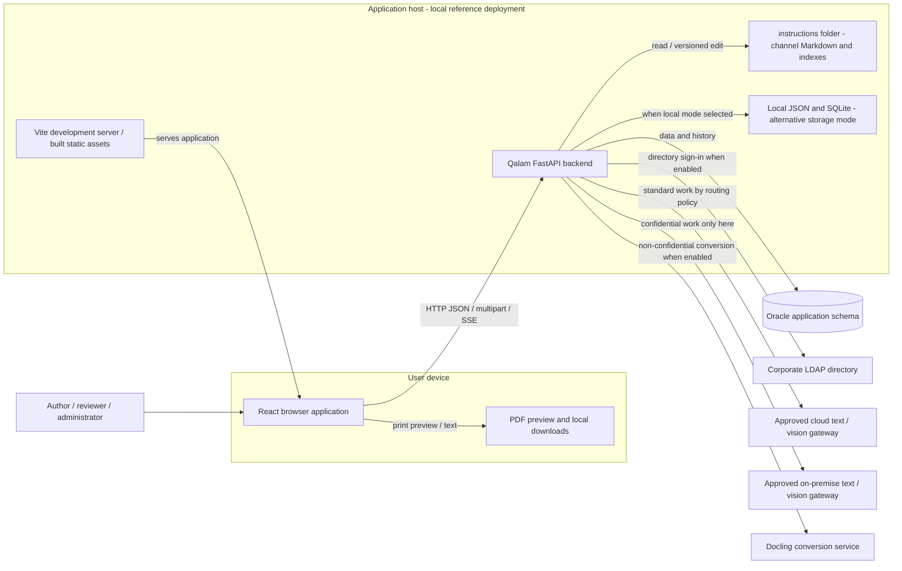
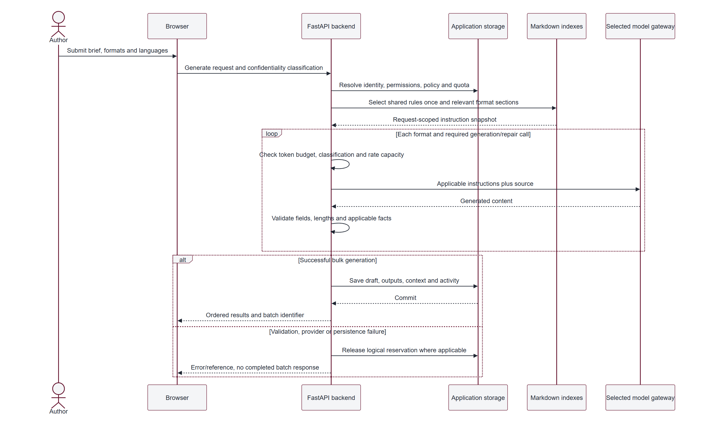
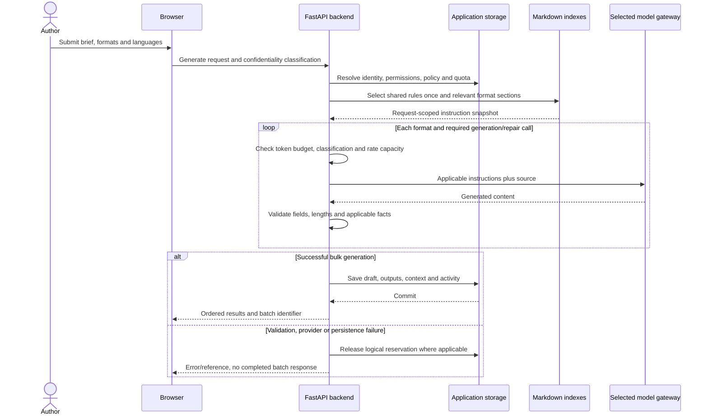
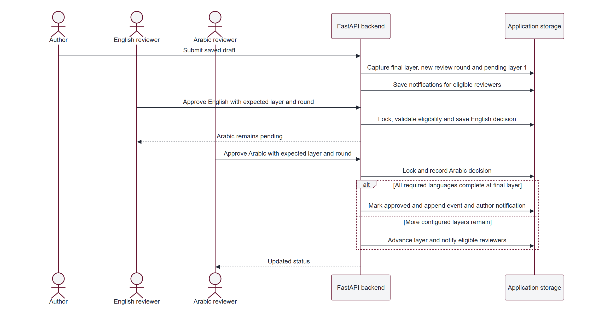
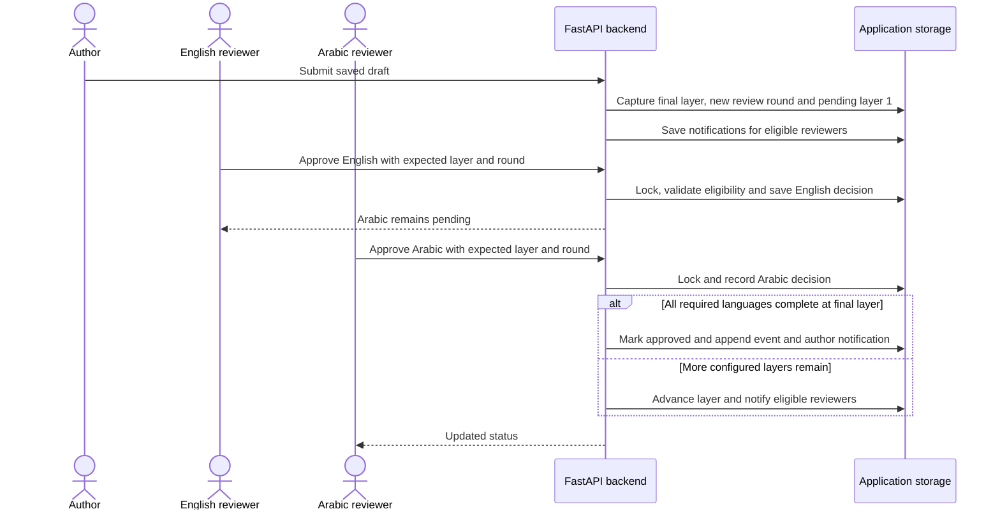
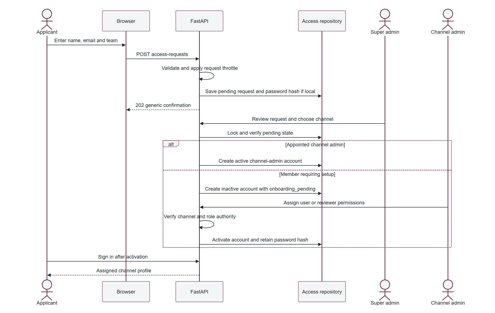
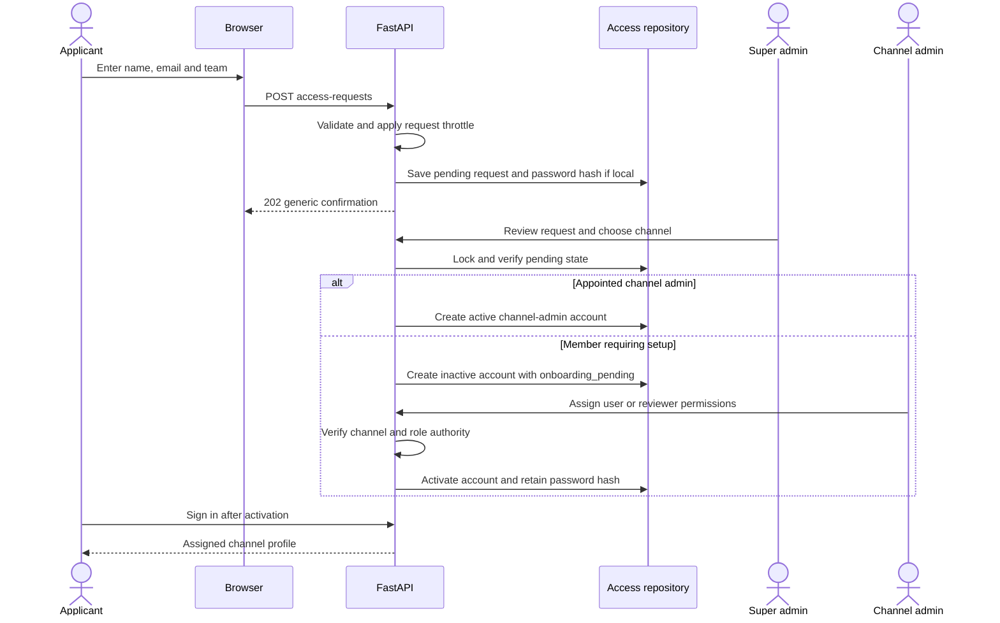
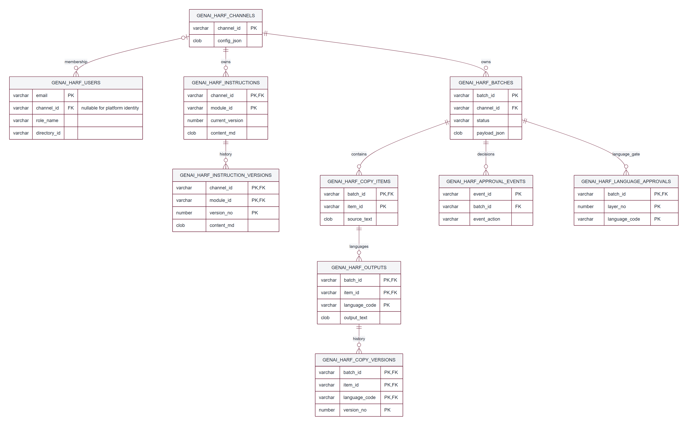
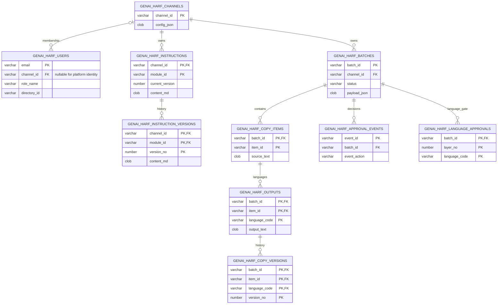

# Qalam Solution Design Document

| Metadata | Value |
| --- | --- |
| Version | 1.1 |
| Date | 9 November 2026, Asia/Dubai |
| Status | Draft — technical and deployment review required |
| Owner | [TBD: accountable application owner and operational support owner] |
| Design basis | **Current** implementation; recommendations and deployment requirements are explicitly labelled **Proposed** or **TBD** |
| Repository | [Digital Design AI Content Accelerator](https://github.com/BasselMahrousseh/Digital-Design-AI-Content-Accelerator), branch `Final_Copywriter` |
| Revision | `775a13c85e96ff9132f8f0801b0f9a8b286622be` |
| Working-tree boundary | Application baseline is the revision above. This documentation update changes the SDD, its rendered diagrams and Word deliverable only; no application code, configuration or database migration is changed. |
| Authoring references | Supplied **SDD Generation — AI Instructions v3.0** and **Solution Design Document — Reference v3.0**, both dated 15 October 2026 |
| Evidence boundary | Repository source, SQL definitions, sanitized configuration examples, and recorded local validation from 9 November 2026. Private environment contents, stored customer content and credentials were not read for this update. No live model, LDAP, OCR or database mutation was performed for this document. |

Source links resolve relative to this document. The verified source-anchor map in Section 8 provides current line ranges for changed contracts and core flows at the revision above. Runtime configuration can differ from code defaults; a default is not evidence that a deployment uses it.

## 1. Purpose, Scope, and Constraints

Qalam is an internal AI-assisted writing application for authors, language reviewers and channel administrators. It converts briefs and existing text into channel-appropriate content, supports English and Arabic, and retains context through editing, export and approval. The intended outcome is consistent content governed by each channel's instructions, with human control over publication readiness.

### 1.1 Included capabilities

| Area | Current implementation |
| --- | --- |
| Author workspace | Write, improve, review and translate; single-copy and bulk modes; component/template selection; optional additional instructions and AI enhancement; rendered editing; archives; document exports |
| Business channels | B2B, B2C, Regulatory Compliance and independent CX Comms instructions; configurable new channels with neutral starter instructions |
| B2B formats | Indexed website Components 1–17 and separate Google Paid Search rules |
| Language support | English, Arabic or both; context-sensitive Arabic instructions; per-language review decisions |
| Guidance | System instructions, indexed template instructions and a user/admin guide; editable Markdown with history and restore; only applicable instruction sections enter generation |
| Access onboarding | Public invite form; super-admin channel assignment; immediate channel-admin activation; member/reviewer activation by the assigned channel admin |
| Governance | Channel membership, reviewer language/layer assignments, configurable final approval layer, feedback and activity views, request allocations, model routing and operational-log retention |
| Files | DOCX, TXT, PDF, XLSX, CSV and supported screenshots; Word/Excel generation in the backend, PDF preview/printing and text download in the frontend |
| Leadership visibility | Channel aggregates, output mix, participation and estimated hours saved; estimates are not measured productivity gains |

Sources: [frontend routes](../src/App.jsx); [generation and file interfaces](../backend/copywriter.py); [bulk workflow](../backend/approval.py); [instruction registry and selection](../backend/access_control.py).

### 1.2 Exclusions and constraints

- Imagine/image-generation functionality is outside the current application. Screenshot reading is document input, not an image-design workspace.
- Qalam does not autonomously publish content or send customer communications. In-app approval is a recorded decision, not external distribution.
- The internal Regulatory Compliance identifier remains `security`; the workspace permission identifier remains `rewrite`. These compatibility identifiers are not additional products.
- The documented launch path is a local Windows development setup. Corporate AIDEV hosting, Oracle service, ingress, directory and gateways require IT confirmation. No production topology is asserted.
- Original upload bytes are processed by extraction; the saved batch contains extracted source text and metadata. A durable original-file/object-storage archive was not found in the inspected upload/save paths.
- Numeric scan validation deliberately blocks uncertain readings. AI generation and scoring do not guarantee factual or regulatory correctness.
- Agreed throughput, latency, availability, RPO/RTO and business success targets are **TBD**; see R6 in Section 8.

Sources: [upload handling](../backend/copywriter.py); [saved batch shape](../backend/approval.py); [compatibility identifiers](../backend/access_control.py); [local launch](../backend/main.py).

## 2. Architecture and Decisions

### 2.1 Solution view



[Open scalable diagram](diagrams/harf-architecture.svg)

<details>
<summary>Editable Mermaid source</summary>



</details>

Cloud and on-premise services are separate trust destinations. No confidential request may fall back to cloud. The actual placement and upstream behaviour of the approved on-premise gateway require IT verification; the application cannot attest to that gateway's network routing.

### 2.2 Components and topology

| Component | Responsibility and implementation |
| --- | --- |
| Browser application | React 19, React Router 7, Vite 8 and Lucide icons. Routes include sign-in, welcome, copywriter, guidelines, activity and administration. Frontend route guards improve UX; backend authorization remains authoritative. |
| FastAPI backend | One deployable Python application; generation, permissions, extraction, exports, approvals and administration are modules in the same process. Uvicorn binds to loopback port 8000 in the supplied entry point. |
| Request execution | Streaming responses for selected text paths; bounded thread pools/semaphores for bulk/component work. No durable distributed job broker was found. A request interruption is not a resumable background job. |
| Storage adapter | Explicit `REWRITE_STORAGE_BACKEND=local/oracle`; Oracle failures do not fall back to stale local data. Oracle uses a bounded pool, transactions, revision checks and locks. |
| Instruction library | Root `instructions/` directory with channel files, preserved reference modules and file-backed prompt selection with cached indexes; Oracle mode also persists current instructions and historical versions. Startup synchronizes database-backed instructions to the local files. |
| External adapters | Legacy Azure client or policy-controlled cloud Responses/on-premise Chat Completions; optional Docling; LDAP authentication adapter. |
| Environment loader | One root `.env` resolved independently of working directory. Admin writes preserve unrelated keys; controlled deployment environment injection remains supported. |
| Scheduled work | An in-process hourly retention worker, started and cancelled with backend lifespan; not a separate scheduler service. |

Sources: [dependencies](../package.json), [Python dependencies](../backend/requirements.txt); [application lifecycle](../backend/main.py); [Vite proxy](../vite.config.js); [storage switch](../backend/storage_backend.py); [Oracle runtime](../backend/oracle_runtime.py); [retention worker](../backend/platform_policy.py).

### 2.3 Consequential design choices

| Current choice | Consequence / tradeoff |
| --- | --- |
| Application-level channel isolation | A shared service/schema supports multiple workspaces. Every content operation must enforce user/channel scope; a SQL view alone does not enforce tenancy. |
| Deterministic indexed retrieval | Selects explicit component/template sections and glossary entries without a vector database. Retrieval is explainable and avoids an embedding service, but lexical matching and dependencies require regression coverage. |
| Shared request instruction snapshot | Avoids repeated file selection across components and languages. Each separate model call still includes the applicable rules and incurs its own input tokens. |
| Runtime JSON state plus relational projections | Preserves existing application data and flexible metadata while exposing relational tables. Revision/locking safeguards reduce lost updates, but aggregate-state serialization may constrain concurrency. |
| Confidential processing fails closed | Missing internal model, credentials or approved image capability blocks processing instead of sending protected data elsewhere. |
| Browser PDF printing | Uses the browser's rendering/print pipeline; installed fonts, browser version and user print settings can affect the final PDF. |

These tradeoffs follow the implementation; no formal ADR or original selection rationale was supplied. Sources: [retrieval](../backend/structure_retrieval.py), [request context](../backend/generation_context.py) ; [Oracle state/projections](../backend/oracle_runtime.py) ; [routing](../backend/inference.py) ; [PDF preview](../public/export-preview.html).

## 3. Interfaces and Key Sequences

### 3.1 HTTP contract and permissions

FastAPI route definitions and Pydantic models are the maintained contract. FastAPI's generated `/openapi.json` and `/docs` are available under its default configuration; a separate hand-maintained OpenAPI file is not introduced here. Paths use `/api` without an explicit version prefix. Public root/health routes do not prove a successful write or AI connection.

| Method and path family | Purpose | Required scope |
| --- | --- | --- |
| `GET /api/access/request-options`; `POST /api/access/access-requests` | Public sign-in-mode discovery and access application | No channel inventory exposed; validated name/email/team; local password only in local mode; submission throttling |
| `GET /api/access/access-requests`; `POST /api/access/access-requests/{request_id}/review` | Review queue, decline or assign a channel and activation type | Super admin only; pending-state and channel checks under storage lock |
| `POST /api/access/login`; `GET /api/access/me` | Authenticate and return assigned profile | Login is public; profile requires current user |
| `GET /api/output-options?team_channel=…` | Available component/template options | Workspace and channel access |
| `POST /api/enhance`, `/enhance/bilingual`, `/enhance/stream`, `/regenerate` | Generate or revise copy | Workspace and requested channel; monthly quota on decorated actions |
| `POST /api/translate`, `/translate/stream` | Translate output | Workspace and requested channel |
| `POST /api/detect-context`, `/analyze`, `/enhance-generation-instructions` | Context, guideline/source assessment, instruction enhancement | Workspace and requested channel |
| `POST /api/extract-upload`, `/import-spreadsheet` | File extraction and selected spreadsheet rows | Workspace and channel; confidentiality middleware applies |
| `POST /api/export/docx`, `/export/bulk-docx`, `/export/xlsx` | Return generated files from submitted sections | Workspace access; these accept content rather than looking up arbitrary batch IDs |
| `POST /api/bulk/generate` | File × selected-format generation, then save draft | Workspace/channel, monthly quota and channel combination limit |
| `POST /api/approvals/draft`; `GET /api/approvals`, `/approvals/{batch_id}` | Save and retrieve drafts/submissions | Own content or channel-authorized visibility; reviewer views are filtered |
| `PUT /api/approvals/{batch_id}/copy`; `POST …/move` | Edit permitted copy / submit | Ownership or permitted channel-admin action; state constraints |
| `POST /api/approvals/{batch_id}/decision` | Approve, reject, note or return | Eligible reviewer, correct channel/layer/round/language |
| `POST /api/approvals/{batch_id}/admin-action` | Override, reject, return, note, warning, urgent flag | Channel admin only, mandatory reason and state checks |
| `GET /api/notifications`; `POST /api/notifications/{notification_id}/read` | In-app inbox/read state | Recipient visibility |
| `GET /api/activity`, `/activity/{row_id}` | Read-only activity projection | User/reviewer own activity; channel admin own channel; super admin own activity only |
| `/api/feedback` POST/GET; `/mine` GET; `/{feedback_id}` GET/PATCH | Submit feedback and channel-admin review | Submission/own lookup checks; management restricted to owning channel admin |
| `/api/access/channels` POST; `/channels/{channel_id}` DELETE | Create / soft-delete channel | Super admin |
| `/api/access/assignments` PUT; `/channels/{channel_id}/users/{email}` DELETE | Assign access / remove member | Role/channel restrictions; protected accounts |
| `/api/access/channels/{channel_id}/instructions` GET; `/{module_id}` GET/PUT; `/versions` GET; `/versions/{version}` GET; `/restore` POST below version | Read, edit, inspect history and restore | Admins for editing/history; ordinary users receive only their guide's user part; approval role excluded |
| `POST /api/access/channels/{channel_id}/refine-instructions` | Produce Markdown suggestion and placement guidance | Channel/super admin; no automatic instruction update |
| `GET/PUT /api/access/channels/{channel_id}/prompt`; `POST …/retrieval-preview` | Legacy prompt management and retained diagnostic retrieval API | Admin/channel guards; retrieval test UI removed |
| `GET /api/access/overview`, `/channels/{channel_id}/performance`, `/platform-overview` | Administration and aggregate metrics | Role-specific privacy projections; platform overview is super-admin aggregate access |
| `GET/PUT /api/access/channels/{channel_id}/approval-policy`, `/bulk-limit` | Final layer and bulk capacity | Own-channel admin where applicable; super admin can manage bulk capacity but not channel approval policy |
| `/api/access/request-limits/{channel_id}` GET; `/channel` PUT; `/users/{email}` PUT | Monthly logical request allocation | Super admin sets channel allowance; channel admin allocates within assigned scope |
| `GET/PUT /api/access/llm-request-limits` | Outbound attempt rate settings | Super admin |
| `GET/PUT /api/access/inference/policy`; `POST /models/{model_id}/test` | Model inventory/routing and synthetic connection test | Super admin |
| `GET/PUT /api/access/platform-policy`; `POST /cleanup` | Retention policy and cleanup | Super admin |
| `GET /api/`, `/api/health/storage` | Liveness / storage-read check | Public in current implementation |

This is a grouped inventory, not a replacement specification. Exact payloads, permission branches and additional query parameters are defined in [copywriter routes](../backend/copywriter.py), [admin routes](../backend/admin.py), [access-request routes](../backend/access_requests.py), [approval routes](../backend/approval.py), [feedback routes](../backend/feedback.py), [activity routes](../backend/activity_tracker.py), [model routes](../backend/inference_admin.py) and [platform policy](../backend/platform_policy.py). Current line anchors for key responsibilities are listed in Section 8.

### 3.2 Representative payloads and operational behaviour

Synthetic standard generation request (`POST /api/enhance`):

```json
{
  "feedback": "Daily backups and file recovery. Support is available 24/7.",
  "task": "improve",
  "channel": "Website",
  "audience": "Business customers",
  "team_channel": "b2b",
  "instructions": "Use Component 3. Preserve only the supplied claims.",
  "output_language": "en"
}
```

Response fields are `original`, `enhanced`, `channel`, `audience`. Bilingual generation instead returns `english` and `arabic`. Generation instructions are limited to 4,000 characters in this request model. Bulk requests contain `items`, `output_ids` and `languages`; their capacity check applies to **files × selected formats**, with two languages sharing one combination. The default channel bulk limit is 20, adjustable from 1 to 100 file/format combinations. Uploaded ordinary briefs have a 10 MB limit; Regulatory Compliance supports 50 MB and up to 2 million extracted characters. Spreadsheet imports use a separate 10 MB bound. These limits are independent of model token capacity.

Streaming uses `text/event-stream` over POST, parsed by the frontend. JSON frames contain `type: delta` with `text`, then `type: done`; failure emits an error frame with a reference. A 200 streaming response can subsequently fail, so clients must require the terminal success frame. No reconnect/resume cursor is implemented. Monthly quota reservations become completed only on success, including terminal streaming success; failures release reservations. AI attempts, including retries/repairs, still count against rolling-minute capacity.

Status semantics include 401 invalid identity, 403 denied action, 404 unavailable scoped resource, 409 stale revision/state or routing conflict, 413 input/file/token limit, 422 invalid input/component, 429 capacity exhaustion, 502 provider/conversion failure and 503 unavailable storage/directory. Individual endpoint mappings differ. Provider failure text is sanitized and correlation references are logged. No general-purpose idempotency-key contract was found for generation: repeating a successful POST may create another batch or consume another logical request.

Activity pagination uses `offset`, `limit` (default 25, maximum 100) and expandable cell previews. Instruction history uses offset/limit (default 20, maximum 100); feedback uses 20-item pages. Approval lists use filters/summary flags, not the same pagination contract.

Sources: `backend/copywriter.py`; `backend/approval.py`; `backend/request_limits.py`; `backend/activity_tracker.py`; `backend/admin.py`; `backend/feedback.py`; [stream client](../src/text-stream.js); [bulk policy](../backend/bulk_limits.py).

### 3.3 Generation sequence



[Open scalable diagram](diagrams/harf-generation-sequence.svg)

<details>
<summary>Editable Mermaid source</summary>



</details>

For bulk generation, a failed item aborts the batch response rather than persisting partial success as a completed batch. Previously executed provider calls can still have incurred cost. B2B parallel work preserves the user's selected order. Other single-copy paths can stream to the browser and save through a later explicit draft operation. Sources: `backend/approval.py`; `backend/copywriter.py`, ; `backend/generation_context.py`.

### 3.4 Approval sequence



[Open scalable diagram](diagrams/harf-approval-sequence.svg)

<details>
<summary>Editable Mermaid source</summary>



</details>

One eligible approval **per required language** is sufficient at each layer. A reviewer assigned both languages may approve both. A later change to the channel's final layer does not silently rewrite a pending submission's captured route. Return/resubmission starts a new round and clears prior language approvals. The API accepts expected layer/round fields and checks supplied stale values; clients should send them. Channel-admin override is a distinct final-approval path with a required reason and recorded method. Super admins cannot approve other channel content. These are stored in-app notifications, not evidence of email/SMS delivery.

Sources: `backend/approval.py`; [approval policy](../backend/approval_policy.py); [concurrency locking](../backend/storage_lock.py) .

### 3.5 Access request and activation sequence

The sign-in form opens a centred request dialog. Applicants enter a name, work email and team; local-mode applicants choose a password of at least eight characters. Directory-mode applicants do not submit a directory password through this form. A generic `202` confirmation avoids revealing whether an email already exists. This is an access application, not proof that the applicant controls the supplied email address. No verification or invitation email is sent.

Only super admins can list and review requests, under **People and access**. They select an active channel and either assign a member awaiting setup or activate a channel admin immediately. Pending members remain inactive and cannot authenticate. The assigned channel admin selects user or reviewer permissions, review layer and review languages before saving access. Super admins cannot bypass this handoff to activate a pending ordinary member; they may promote that person to channel admin. An already-reviewed request returns `409` if another decision is attempted. Duplicate submissions get the same generic public response.



[Open scalable diagram](diagrams/qalam-access-request-sequence.svg)

<details>
<summary>Editable Mermaid source</summary>



</details>

The UI uses compact applicant cards, explicit Member/Channel admin choices, optional review notes and reviewed history. Admin activation and decline actions have confirmation dialogs. The public form accepts ten validated attempts per client address per hour **per backend process**, with bounded in-memory address tracking and at most 10,000 pending requests. Restarting the process resets the address throttle. A shared gateway limiter, pagination, mailbox verification and notification delivery are **Proposed**, not implemented production controls (R4/R10).

Sources: [access request contracts](../backend/access_requests.py), [public form](../src/components/access-request.jsx), [review interface](../src/components/access-requests-admin.jsx), [member activation](../backend/admin.py).

## 4. Data and Schema

### 4.1 Persistence model

Branding is Qalam; compatibility storage identifiers remain unchanged. The Oracle owner remains `REWRITE_APP`; current physical table names use `GENAI_HARF_`. The recorded local service is `FREEPDB1`; the target AIDEV service and supported production engine release remain **TBD**. There are 19 application/support table definitions: 17 in baseline schema 001, one migration-snapshot table and one runtime-state table. The supplied verification report records a local migration, but the database was not queried for this SDD.

Oracle mode keeps access-domain state in `GENAI_HARF_RUNTIME_STATE.ACCESS_JSON` with an incrementing revision. Changed entities are projected transactionally into relational tables. Feedback, instruction versions and monthly quotas use their own repository paths. Access requests are stored in the runtime JSON `access_requests` collection; no separate access-request table or new schema migration is introduced. Approved accounts are projected into the existing users table. Request records include review status, assigned channel/role, decision note and reviewer/time. Password hashes are excluded from request-list/review responses and removed from reviewed request records after assignment or rejection. Model policies, confidentiality fingerprints and aggregates also live in runtime JSON; they are not independent physical tables. The ERD below intentionally omits a request entity because these requests are JSON records, not a relational table. Oracle does not replace instruction files with a vector database: generation still reads indexed Markdown synchronized to the application host.

Local mode uses access JSON plus SQLite repositories for history, feedback, quotas and minute-limit state. It is an explicitly selected alternative, not disaster-recovery failover. Original binary source-file retention is not implemented by the inspected upload path; extracted source and file metadata can be retained in saved copies/activity/feedback.

Sources: [mapping](../backend/oracle_mapping.py) ; [runtime persistence](../backend/oracle_runtime.py) ; [instruction repository](../backend/oracle_instructions.py) ; [storage selection](../backend/storage_backend.py) .

### 4.2 Scoped ERD

All names below are physical table names. Attributes show selected keys, not full definitions. Links are database-enforced foreign keys; author/reviewer email snapshots are deliberately not drawn as enforced user relationships.



[Open scalable diagram](diagrams/harf-data-model.svg)

<details>
<summary>Editable Mermaid source</summary>



</details>

The user membership FK is nullable: a channel can have zero users and a user can have zero or one channel. Other displayed child-parent links require one parent.

The remaining nine tables are `GENAI_HARF_NOTIFICATIONS`, `GENAI_HARF_ACTIVITY`, `GENAI_HARF_FEEDBACK`, `GENAI_HARF_CHANNEL_LIMITS`, `GENAI_HARF_USER_LIMITS`, `GENAI_HARF_REQUEST_USAGE`, `GENAI_HARF_SCHEMA_VERSIONS`, `GENAI_HARF_MIGRATION_SNAPSHOTS` and `GENAI_HARF_RUNTIME_STATE`. They store inbox events, activity, feedback snapshots, allocations/reservations and schema/recovery/runtime state. Runtime state references its migration snapshot. Principal IDs and historical actor emails are logical identity references, not universal user-table FKs.

Authoritative schema: [01_create_tables.sql](../database/oracle/01_create_tables.sql) , [03_migration_safety.sql](../database/oracle/03_migration_safety.sql) , [04_runtime_storage.sql](../database/oracle/04_runtime_storage.sql) .

### 4.3 Constraints, indexes and lifecycle

- Oracle text identifiers use `VARCHAR2(... CHAR)`, long text uses CLOB, JSON CLOBs have `IS JSON` checks, and timestamps use `TIMESTAMP(6) WITH TIME ZONE`.
- Output PK is `(batch_id, item_id, language_code)`; language is constrained to `en|ar`. Historical output adds `version_no`. Instruction history PK is `(channel_id,module_id,version_no)`.
- Batch state checks allow draft, pending layers 1–3, returned, approved and rejected. Language approvals are unique per `(batch_id,layer_no,language_code)`; full audit events survive beyond this current-state projection.
- Indexes support channel users, approval queues, author batches, notification inboxes, channel/actor activity, feedback and monthly usage. Full DDL defines sizes/defaults; this SDD does not provide alternative bootstrap SQL.
- Baseline views `RW_APPROVAL_QUEUE` and `RW_CHANNEL_REQUEST_USAGE` plus four legacy adapter views are retained. Recorded renames also created compatibility views for earlier table prefixes; they are not duplicate physical storage.
- Default retention is **180 days**, configurable by super admin between 31 and 3,650 days. Cleanup removes eligible activity, notifications, old daily token/performance aggregates, old rate-setting history and expired historical request reservations. It preserves current billing-month counters/live reservations, saved copies, approval evidence, feedback and instruction versions. Undated records are preserved rather than guessed away.
- “180-day retention” therefore does **not** mean all personal/customer content disappears after 180 days. Data classification, long-term saved-content retention and deletion obligations require review (R5).

Sources: `database/oracle/01_create_tables.sql`; `database/oracle/04_runtime_storage.sql`; [rename runbook](../docs/Harf_Database_Rename.md); `backend/platform_policy.py`.

### 4.4 Instruction folder compatibility and controlled cleanup

Active instructions have moved from `Copywriter/backend/prompt/` to root `instructions/`. The channel and instruction-pack subfolders, filenames and all 32 moved files were verified byte-for-byte. Selection constants, B2B component lookup, migration snapshots and recovery references use the current layout. The old path remains accepted only for historical backup compatibility. New recovery exports normalize source paths to `instructions/`; restores map old and new snapshot paths into that folder and reject traversal/unrelated paths. Existing backup artifacts are not rewritten. Vite denies direct browser access to `instructions/`, just as it denied the former location.

The optional [08_clear_saved_copies.sql](../database/oracle/08_clear_saved_copies.sql) is a deliberate **destructive maintenance reset**, not an installation migration. With the backend stopped and a fresh backup, it removes all saved batches, extracted inputs, outputs, copy versions, approval decisions and notifications across channels, then updates aggregate runtime state and its revision in the same transaction. It preserves users, instructions, feedback, activity, limits and migration backups. It does not commit automatically: the operator must run `COMMIT` or `ROLLBACK` in the same connection before restarting the backend. Deletion does not guarantee that Oracle allocated space or physical data files shrink. Independent feedback, activity and backups can still retain content; this is not a full data-erasure procedure.

Sources: [path compatibility](../backend/instruction_locations.py), [backup and restore](../backend/oracle_recovery.py), [snapshot builder](../backend/oracle_migration.py), [Vite boundary](../vite.config.js).

## 5. AI Design

### 5.1 Models and inference

Current code supports two policy gateways: **cloud Responses API** and **on-premise Chat Completions**. Super admins manage enabled model records, upstream deployment names, vision approval, input/output caps and per-channel/default/confidential selection. Catalog entries are configured inventory, not proof that a deployment exists. Provider connections remain environment-owned; no database credential management is implemented.

When standard live routing is not enabled, the application can use the legacy Azure adapter (`2024-10-21` API version). `MODEL_PROVIDER=mock` blocks live calls rather than returning fabricated copy. In live mode, gateway protocol and HTTPS connection shape are validated. Requests pin a route/policy snapshot; explicit input-limit overrides are reread at each call. Confidential work always resolves to an enabled on-premise model, including revisions, scoring and OCR, without cloud fallback. A model must be approved for image reading before image content is sent.

Model defaults are 64,000 input tokens and 4,096 output tokens in the model schema, with positive whole-number overrides. These are application budgets, not claims about provider context windows. Input accounting includes prompt instructions and source; known models use a local tokenizer with framing allowance, unknown cases use a conservative estimate, and images reserve an estimated allowance. Output allowance is separately passed to the provider. No monthly token budget is currently implemented; monthly logical request limits and actual token reporting are separate controls.

Sources: `backend/inference_admin.py`; `backend/inference.py`; `backend/ai_service.py`; `backend/input_tokens.py`; `backend/platform_policy.py`. Configuration guidance: [Inference_Routing.md](../docs/Inference_Routing.md), [Input_Tokens_and_Retention.md](../docs/Input_Tokens_and_Retention.md), [sanitized inference example](../backend/inference.env.example).

### 5.2 Instruction retrieval and lifecycle

1. Resolve the authorized business channel and its active three-file pack. The guide is for people and is excluded from generation prompts.
2. Select standard system rules once for the logical request using all relevant briefs. Preserve mandatory rules and terminology constraints.
3. Resolve indexed template/component IDs and dependencies. Website schemas and paid-search rules remain separate; a requested component does not require sending all 17 schemas.
4. Select relevant bilingual glossary rows while retaining core/restricted terms. Rank optional examples/reference sections lexically using BM25-style scoring.
5. Reuse file indexes and bounded selection caches while signatures remain unchanged. Administrator saves invalidate selection state; the next request sees the new rules. Request contexts retain their own selection snapshot.
6. Assemble the applicable sections into **each** required model call. File-selection reuse does not eliminate repeated prompt tokens or imply provider prompt-cache hits.

This is structured, lexical instruction retrieval. No embedding model, vector database, learned retrieval policy or autonomous retrieval agent was found in the inspected implementation. “STAIR-like” is a useful informal description of hierarchical selection, not evidence that a particular research algorithm was reproduced. Uploaded policy documents are source evidence; long regulatory documents are segmented before memo drafting.

Instruction edits require role/channel authorization and version checks. Saves capture content/checksum/author/time/note; restore appends a new version rather than erasing history. The AI Markdown refiner produces a suggestion; an administrator must apply and confirm the file edit. Source-file synchronization and database history must remain aligned across deployment instances (R4).

Sources: `backend/access_control.py`; [structure selector](../backend/structure_retrieval.py) ; [terminology index](../backend/terminology_index.py) ; `backend/generation_context.py`; `backend/admin.py`; [version repository](../backend/instruction_versions.py) ; `backend/ai_service.py`.

### 5.3 Output quality, repair and assessment

Website generation uses structured component records and deterministic field budgets, then renders user-facing output. Validation checks required fields, character limits, language metadata and relevant commercial qualifications. Bounded targeted repairs can ask the model to fix offending fields; exhaustion produces a component-specific error instead of silently accepting invalid copy. Applicable multi-component review can flag repetitions, contradictions and weak progression without replacing human review.

English and Arabic outputs are treated separately. Arabic prompts require meaning-based professional wording, approved terminology and preservation of facts, rather than literal word substitution. Assessments combine source inventories, literal checks, component checks and AI judgement, with references to selected guidance. Scores are advisory: similarity or a high score does not prove every fact is preserved. Cached reviews are keyed to content/context and model route/classification; caches are process-local and bounded. Exported scores may be partial AI assessments where only excerpts were reviewed and must retain that label.

DOCX extraction traverses document XML, headers, footers, nested tables, hyperlinks, content controls and text boxes; it excludes deleted revision text. Text decoding supports UTF-8 and UTF-16 variants, subject to file validation. Image prompts request all visible text, and the configured PDF/vision fallback may extract scanned pages when Docling is unavailable or bypassed. These improvements do not prove that every layout, handwriting sample or Arabic scan is read correctly.

OCR compares independent numeric readings and refuses unresolved disagreement. Docling is an input-conversion service, not a PDF/Word/Excel export engine. Standard conversion can submit a remote task and poll for a result; confidential documents bypass external Docling. Service health alone does not prove Arabic OCR works (R2).

No model-directed tool/function execution loop or agent framework was found in these generation paths. Python functions orchestrate extraction, retrieval, validation and saves under application control. The model cannot directly approve a batch, modify a database or edit an instruction file.

Sources: [document extraction](../backend/document_text.py), [component contracts](../backend/component_records.py); `backend/ai_service.py`; [set review](../backend/component_set_review.py) ; [quality normalization](../backend/quality_analysis.py); [assessment cache](../backend/assessment_cache.py) ; [OCR](../backend/scan_ocr.py) ; [Docling](../backend/docling_client.py) ; `backend/copy_export.py`.

## 6. Security and Operational Requirements

### 6.1 Identity and access boundaries

| Role | Effective content / administration scope |
| --- | --- |
| User | Own channel writing; own archive/activity/feedback lookup; user part of guide |
| Reviewer (`approval_admin`; channel admins can also review their channel) | Assigned channel, review layer and language decisions; source/context for permitted submissions; no AI instruction-library access for the approval role |
| Channel admin | Own channel users, instructions, activity, feedback and approval administration; explicit reason for overrides |
| Super admin | Channel lifecycle, allocations, models, retention, instructions and aggregate overview; own writing remains available; other users' copy/feedback/approvals remain private |

LDAP authentication binds a service identity to search, escapes LDAP filter values, validates the user's bind and records a stable directory identifier. An active application-assigned user is still required; directory membership does not automatically grant a role. TLS certificate validation defaults to enabled but is configurable. `DEVELOPER_MODE=true` switches to local authentication.

**Material limitation:** in local mode subsequent API identity is accepted through `X-User-Email` for an assigned user. The local password hash is a simple SHA-256 hash, not a salted password KDF. This must remain a trusted local-development mode. LDAP mode instead requires a signed bearer token and matching assigned directory identity. Despite `JWT_*` setting names, the implemented session token is a custom two-part HMAC-signed payload, not a standard three-part JWT. Deployment identity/session controls require security review (R3).

Sources: `backend/access_control.py`; `backend/directory_auth.py`; `backend/admin.py`; `backend/activity_tracker.py`; `backend/feedback.py`; `backend/approval.py`.

### 6.2 Threats and implemented controls

| Threat | Current controls and remaining boundary |
| --- | --- |
| Cross-channel or privileged content exposure | Backend channel/ownership checks and role-specific projections. Super-admin aggregate access does not grant other-user content access. Database views do not independently enforce this. |
| Confidential content sent to cloud | Request classification, channel-scoped exact-content/file fingerprints, saved-copy provenance, on-premise-only resolution and no cloud fallback. Mark before upload. Paraphrased/untracked content cannot be reliably recognized by exact hashes. |
| Instructions in untrusted documents | System/task constraints separate source facts from policy, restrict invention and validate outputs. This is not a proven prompt-injection defence; adversarial evaluation remains required. |
| Unsupported/malicious uploads | Size and format validation, extraction limits, safe spreadsheet text treatment, OCR numeric disagreement checks. Antivirus, sandboxed document processing and archive/decompression limits across all parsers require deployment review. |
| Browser output injection | Review frontend renderer/editor sanitation paths before deployment; no claim of a completed XSS security assessment. |
| Credential exposure | Environment-owned credentials; no credentials in model catalog; Vite denies sensitive directories/files including the renamed instruction folder. The current application revision tracks a populated `.env` at the team’s request. This retains configuration secrets in repository history; repository permissions, approved distribution and credential rotation require explicit review. No secret values are reproduced in this SDD (R3/R10). |
| Concurrent changes | Oracle revision checks/transactions, bounded locks, expected instruction versions and review rounds. Conflicts return errors; no universal request replay guarantee. |

Sources: [classification middleware](../backend/inference_guard.py); `backend/inference.py`; `backend/docling_client.py`; [spreadsheet import](../backend/spreadsheet_import.py); `backend/copy_export.py`; [browser renderer](../src/components/copy-editor.jsx); [Vite configuration](../vite.config.js); `backend/oracle_runtime.py`; `backend/storage_lock.py`.

### 6.3 Operations, limits and observability

- Outbound LLM attempts use a rolling 60-second application limit and per-channel limit, both defaulting to **50**. Super-admin settings persist to the single root `.env` through key-specific updates. Waiting is bounded (default 120 seconds), with a bounded local waiter pool; all outbound AI attempts count, including repairs and retries. This is separate from monthly user/channel action allocations.
- Oracle pool defaults: minimum 1, maximum 6, 10-second pool wait/connect timeout, 30-second call timeout; key write locks use a 10-second wait. These are configured/code values, not availability or performance guarantees.
- Streaming sends incremental text and sanitized errors. Bulk work is bounded but tied to request execution. There is no verified durable retry/replay worker or cross-host scheduling deployment.
- Logs record technical type/code/reference rather than raw provider messages in inspected stream/bulk failure paths. Activity and feedback deliberately store source/output context and therefore remain sensitive data.
- `/api/health/storage` verifies a read of runtime state only. It can pass while writes fail due to storage quota. Release checks must test a controlled write/read/rollback, not just health.
- Token usage records provider usage when supplied; unknown usage must not be treated as zero. Dashboard hours saved are estimates, not measured time-tracking evidence.
- Current CORS allows all origins. Production ingress/TLS, allowed origins, alerts, secrets management, database encryption, backups and support escalation are **TBD** (R3/R6). Repository inspection does not establish organization-wide security compliance.

Sources: `backend/llm_rate_limits.py`; `backend/oracle_runtime.py`; `backend/main.py`; [token usage](../backend/token_usage.py); [performance](../backend/channel_performance.py); [rate control runbook](../docs/LLM_Request_Control.md).

## 7. Delivery and Validation

### 7.1 Build, configuration and migration

Frontend: `npm install`, `npm run dev`; distribution build: `npm run build`. Backend: create a Python environment, install [requirements](../backend/requirements.txt), run `backend/main.py`. Vite proxies `/api` to loopback port 8000. A production static host/reverse proxy and backend process supervision are not defined by this development proxy. No `.github` CI/CD directory was found in the inspected checkout.

The sole normal runtime file is the project root `.env`, resolved by `backend/environment.py`. Previous backend/Copywriter, Oracle-local, minute-limit and platform-policy files were consolidated, with private originals preserved under ignored `backups/config/`. Text-specific settings retain `COPYWRITER_AZURE_OPENAI_*` overrides. Settings injected by the deployment environment take precedence on startup; the existing managed controls read saved root-file values. Key-specific admin writes preserve credentials/comments and are serialized within a process. Backend restart is required for connection changes. Model policies and request/retention controls follow their existing live update paths.

Use the root [.env.example](../.env.example) and sanitized [Oracle](../backend/oracle.env.example), [LDAP](../backend/ldap.env.example), [inference](../backend/inference.env.example), [Docling](../backend/docling.env.example), [rate](../backend/llm-rate.env.example) and [platform-policy](../backend/platform-policy.env.example) examples. Preserve stable compatibility variable names such as `REWRITE_STORAGE_BACKEND`; renaming them is not part of this document. Do not copy credentials into the SDD or frontend.

Database setup is staged, not one interchangeable script:

1. DBA provisions the application owner using [00_create_application_schema.sql](../database/oracle/00_create_application_schema.sql).
2. Connect as the application owner; run baseline [01_create_tables.sql](../database/oracle/01_create_tables.sql), then [02_verify_installation.sql](../database/oracle/02_verify_installation.sql).
3. Apply [03_migration_safety.sql](../database/oracle/03_migration_safety.sql) and [04_runtime_storage.sql](../database/oracle/04_runtime_storage.sql) in order before runtime cutover.
4. Follow [MIGRATION.md](../database/oracle/MIGRATION.md) and the cutover/recovery tools: preserve source snapshots, validate mappings and hashes, stop writers, import, switch runtime, verify and retain rollback artifacts.
5. Existing local installation is recorded at rename version 006 with `GENAI_HARF_` tables. Do **not** rerun fresh-install or historical rename scripts on it. [07_increase_local_storage_quota.sql](../database/oracle/07_increase_local_storage_quota.sql) is a separately privileged capacity repair, not a baseline migration.

Oracle DDL commits immediately. Rename recovery uses verified exports/journals and compensating operations, not transaction rollback alone. Switching back to local source data after new Oracle writes can lose those newer writes unless reconciled. Production backup/restore and cutover acceptance must be repeated in the target environment.

Tests now reside in `TEST/backend/` and `TEST/frontend/`, with all 72 pre-existing test files preserved. Run `npm test` and `backend/.venv/Scripts/python.exe TEST/run_backend.py` from the project root. The backend runner explicitly selects isolated local storage and offline inference before imports; test coverage does not establish deployment acceptance.

Sources: [configuration/access runbook](../docs/Configuration_and_Access_Requests.md), [test guide](../TEST/README.md), [database README](../database/oracle/README.md), [migration runbook](../database/oracle/MIGRATION.md), [cutover implementation](../backend/oracle_cutover.py), [recovery](../backend/oracle_recovery.py), [current rename tool](../backend/oracle_genai_harf_names.py).

### 7.2 Verification evidence and acceptance

| Check | Evidence/status | Interpretation |
| --- | --- | --- |
| Latest recorded backend regression | 516 tests passed on 9 November after the instruction move | Isolated fixtures and mocked providers; includes invite permissions/concurrency, environment preservation and legacy backup restore |
| Latest recorded frontend regression | 55 tests passed and production build passed on 9 November | Covers streams, exports, approvals and other maintained frontend contracts; build reported a large-chunk advisory |
| Latest recorded browser checks | Invite submission, role choices, channel handoff, reviewer activation and desktop/mobile request cards passed using fictional API fixtures | No live test accounts were created; this does not verify email delivery or corporate identity |
| Latest recorded instruction integrity | All 32 moved files matched pre-move SHA-256 values; all four live channels returned their three-file libraries | Confirms the folder move preserved content and current library availability |
| Latest recorded storage health | Local application returned `status: ok, storage: oracle` on 9 November | Read check only; does not prove spare quota or all future writes |
| Earlier saved-copy cleanup | Verified transaction removed old drafts; subsequent operator reset reported clearing 76 batches before explicit commit | Historical successful writes do not establish production capacity; final operator commit was not independently verified for this SDD |
| Recorded Arabic scan | Prior numeric disagreement and Arabic Docling conversion failures remain unresolved by current evidence | New extraction coverage does not close R2 without representative live scans |
| This SDD update | Source/contract comparison, local-link/source-anchor checks, rendered diagrams and Word visual verification | No live model/directory call or migration is part of documentation verification |

Primary historical evidence: [Harf final test report](../docs/Harf_Final_Test_Report_2026-10-30.md). Approval tests: [test_approval_scenarios.py](../TEST/backend/test_approval_scenarios.py), [test_approval_routing.py](../TEST/backend/test_approval_routing.py), [test_language_review.py](../TEST/backend/test_language_review.py). Retrieval tests: [test_generation_context.py](../TEST/backend/test_generation_context.py), [test_retrieval_preview_parity.py](../TEST/backend/test_retrieval_preview_parity.py), [test_terminology_index.py](../TEST/backend/test_terminology_index.py).

**Proposed deployment acceptance:** resolve R1/R2 or explicitly restrict unsupported input paths; disable developer mode and verify assigned LDAP identities; test real approved cloud/internal models including confidential vision; verify user/channel denial cases, instruction-version refresh, full bilingual approval and exports with synthetic content; test representative concurrency, restore and retention; obtain agreed service targets and security approval. No acceptance or risk sign-off is implied by this draft.

## 8. Open Items and Risks

| ID | Type | Issue / assumption | Impact / priority | Next action | Owner / status |
| --- | --- | --- | --- | --- | --- |
| R1 | Recorded blocker | Historical ORA-01536 quota failure; subsequent local cleanup/read checks succeeded, but production write capacity is unverified | High: generated work/approvals may fail to save | Privileged DBA reviews quota; rerun controlled write, archive and approval cycle; do not grant DBA to runtime account | [TBD: DBA], open |
| R2 | Recorded blocker | Scanned Arabic PDF numeric verification and Arabic Docling conversion unresolved | High for regulatory source reliability | Validate OCR engine/languages and approved vision service; retain fail-closed numeric checks; use selectable text meanwhile | [TBD: document-service owner], open |
| R3 | Deployment security | Local header identity/simple password hash, custom bearer format, wildcard CORS, configurable LDAP certificate validation | High if development settings are exposed | Enforce approved identity/TLS/origin/session policy; rotate shared secrets; security review and negative tests | [TBD: identity/security owner], open |
| R4 | Scale / consistency | Shared aggregate-state locks and host-local instruction files/settings/caches | Medium/high for multiple backend instances | Establish deployment topology; synchronize files and managed configuration; test refresh/locking and concurrent writes across instances | [TBD: platform owner], open |
| R5 | Data lifecycle | Retention covers operational logs, not saved copy/feedback/approval history; original binary files not durably archived by upload path | High where sensitive source must be retained or erased | Approve data inventory, residency, saved-content retention/deletion and backup policies; add original-file storage only if required | [TBD: data owner], open |
| R6 | Operations / acceptance | Production hosting, AIDEV version/service, gateway availability, SLA/SLO, expected users, throughput and recovery targets unknown | High before rollout | Confirm target architecture, support ownership and measurable acceptance/load/restore tests | [TBD: application/platform owner], open |
| R7 | AI quality | No universal guarantee for all component inputs, Arabic translations, OCR or advisory scores; prompt injection still possible | High for external/regulatory publication | Maintain representative bilingual evaluation set; adversarial tests, human review and model/instruction change gates | [TBD: content/AI owner], open |
| R8 | Documentation / API drift | Legacy compatibility names remain in historical runbooks/messages; primary README, instruction locations and test commands have been updated | Medium: misleading operational guidance | Align user-facing docs/messages in a separate authorized maintenance change; preserve compatibility identifiers | [TBD: application owner], open |
| R10 | Onboarding / credentials | Public access form does not verify mailbox ownership or send email; client-address throttle is process-local; populated environment configuration is tracked in Git by team request | High before shared deployment | Agree account verification/delivery, shared gateway throttling, repository access and secret distribution/rotation controls | [TBD: identity/security/platform owner], open |
| R9 | Retry / capacity | Bulk failure does not return saved partial success; generation lacks generic idempotency keys; provider calls may be billed before save fails | Medium: duplicate work/cost and user confusion | Validate failure UX; define retry semantics; consider durable jobs/idempotency only if required by target scale | [TBD: application owner], open |

### Revision history

| Version | Date | Change |
| --- | --- | --- |
| 1.0 | 2 November 2026 | Initial eight-section SDD, architecture/sequences/ERD and Word deliverable |
| 1.1 | 9 November 2026 | Qalam branding; access requests and activation; consolidated environment; TEST layout; instruction-folder compatibility; extraction changes; optional reset procedure; refreshed validation and security boundaries |

### Documentation validation record

Validation date: 9 November 2026. This revision checks the eight required sections, local links, current source anchors, access-request contract and 19-table schema inventory. Five editable Mermaid diagrams are rendered as PNG/SVG for the Markdown and embedded into the Word deliverable. Recent application tests and local health observations are reported as recorded evidence above; they are not production acceptance. Documentation work does not change application behavior, private configuration or database contents.

### Current source anchors

| Contract or responsibility | Source at the documented application revision |
| --- | --- |
| Public access submission | [backend/access_requests.py](../backend/access_requests.py) (`backend/access_requests.py:L42-L73`) |
| Super-admin routing | [backend/access_requests.py](../backend/access_requests.py) (`backend/access_requests.py:L84-L111`) |
| Account activation guard | [backend/admin.py](../backend/admin.py) (`backend/admin.py:L416-L456`) |
| Request UI | [src/components/access-requests-admin.jsx](../src/components/access-requests-admin.jsx) (`src/components/access-requests-admin.jsx:L1-L78`) |
| Root environment updates | [backend/environment.py](../backend/environment.py) (`backend/environment.py:L26-L44`) |
| Instruction path compatibility | [backend/instruction_locations.py](../backend/instruction_locations.py) (`backend/instruction_locations.py:L8-L18`) |
| Historic restore mapping | [backend/oracle_recovery.py](../backend/oracle_recovery.py) (`backend/oracle_recovery.py:L147-L176`) |
| Snapshot normalization | [backend/oracle_recovery.py](../backend/oracle_recovery.py) (`backend/oracle_recovery.py:L54-L100`) |
| Snapshot builder | [backend/oracle_migration.py](../backend/oracle_migration.py) (`backend/oracle_migration.py:L49-L73`) |
| Instruction selection | [backend/access_control.py](../backend/access_control.py) (`backend/access_control.py:L370-L427`) |
| Generation snapshot | [backend/generation_context.py](../backend/generation_context.py) (`backend/generation_context.py:L12-L43`) |
| Component validation and repair | [backend/ai_service.py](../backend/ai_service.py) (`backend/ai_service.py:L789-L881`) |
| DOCX content extraction | [backend/document_text.py](../backend/document_text.py) (`backend/document_text.py:L1-L48`) |
| Upload routing | [backend/ai_service.py](../backend/ai_service.py) (`backend/ai_service.py:L1513-L1542`) |
| Oracle save transaction | [backend/oracle_runtime.py](../backend/oracle_runtime.py) (`backend/oracle_runtime.py:L131-L159`) |
| Approval decisions | [backend/approval.py](../backend/approval.py) (`backend/approval.py:L1-L613`) |
| Model routing | [backend/inference.py](../backend/inference.py) (`backend/inference.py:L152-L169`) |
| User log retention | [backend/platform_policy.py](../backend/platform_policy.py) (`backend/platform_policy.py:L61-L91`) |
| Per-minute controls | [backend/llm_rate_limits.py](../backend/llm_rate_limits.py) (`backend/llm_rate_limits.py:L67-L174`) |
