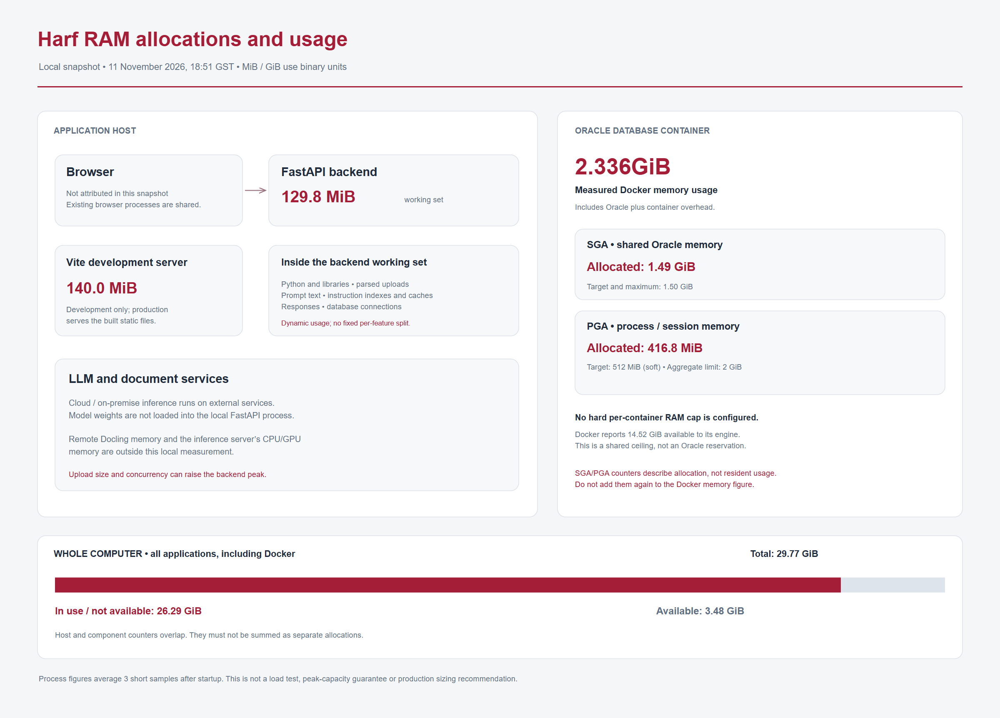

# Harf branding and RAM verification

Date: 11 November 2026, Asia/Dubai.

## Branding changes

The visible application name is Harf. The Arabic حرف logo uses the original mark from page 3 of the supplied Harf Brand guidelines.pdf. The guideline artwork is traced into smooth, resolution-independent SVG paths with no embedded bitmap. The faint banner design reuses these same Arabic Harf paths as white/grey relief and watermark shapes; it is not an AI redrawing. The shared logo component supplies this mark to sign-in, welcome, writing, guidelines and administration. Browser/favicon text, tutorials, invite dialogs, accessibility labels and backend product/API labels were updated.

The logo is an image-based calligraphic brand mark, not a substituted Arabic font. Existing routes, storage identifiers, passwords, environment settings and instruction contents were not renamed. Earlier Qalam image assets remain as unused historical assets; current application code references the Harf assets.

## Edited existing files

- `README.md`
- `backend/access_control.py`
- `backend/admin.py`
- `backend/copywriter.py`
- `backend/main.py`
- `index.html`
- `public/favicon.svg`
- `src/components/BrandLogo.jsx`
- `src/components/HarfIcon.jsx`
- `src/components/access-request.jsx`
- `src/components/admin-guide-button.jsx`
- `src/components/feedback-admin.jsx`
- `src/components/harf-brand.css`
- `src/components/onboarding-tutorial.jsx`
- `src/onboarding-steps.js`
- `src/pages/choose-workspace.jsx`
- `src/pages/guidelines.jsx`
- `src/pages/signin.jsx`
- `src/theme.css`

## Added files

- `docs/Harf_Branding_and_RAM_Report.md`
- `docs/performance/Harf_RAM_Allocation_Usage.png`
- `docs/performance/Harf_RAM_Allocation_Usage.svg`
- `public/harf-favicon.svg`
- `public/harf-logo.svg`
- `src/assets/harf-banner-calligraphy.svg`

## Database names

Read-only live Oracle metadata verified 19 of 19 expected application tables. Every table below retains the GENAI_HARF_ prefix. No schema/table renaming was performed.

- `GENAI_HARF_ACTIVITY`
- `GENAI_HARF_APPROVAL_EVENTS`
- `GENAI_HARF_BATCHES`
- `GENAI_HARF_CHANNELS`
- `GENAI_HARF_CHANNEL_LIMITS`
- `GENAI_HARF_COPY_ITEMS`
- `GENAI_HARF_COPY_VERSIONS`
- `GENAI_HARF_FEEDBACK`
- `GENAI_HARF_INSTRUCTIONS`
- `GENAI_HARF_INSTRUCTION_VERSIONS`
- `GENAI_HARF_LANGUAGE_APPROVALS`
- `GENAI_HARF_MIGRATION_SNAPSHOTS`
- `GENAI_HARF_NOTIFICATIONS`
- `GENAI_HARF_OUTPUTS`
- `GENAI_HARF_REQUEST_USAGE`
- `GENAI_HARF_RUNTIME_STATE`
- `GENAI_HARF_SCHEMA_VERSIONS`
- `GENAI_HARF_USERS`
- `GENAI_HARF_USER_LIMITS`

## RAM allocations and observed usage

[Scalable SVG](performance/Harf_RAM_Allocation_Usage.svg)

Snapshot: 2026-11-11T18:51:17+04:00 (GST). Process working-set figures average three short samples after startup, without a live generation load test.

| Component / metric | Measured value | Meaning |
| --- | --- | --- |
| FastAPI backend | 129.8 MiB | Process working set, including loaded libraries and runtime state |
| Vite development server | 140.0 MiB | Development-only Node process; production serves compiled static assets |
| Oracle container | 2.336GiB | Docker-reported memory usage, including Oracle/container overhead |
| Oracle SGA allocated | 1.49 GiB | Shared System Global Area allocation; not an additional charge on top of the container figure |
| Oracle SGA target / maximum | 1.50 GiB | Configured Oracle shared-memory target/maximum |
| Oracle PGA allocated | 416.8 MiB | Instance-wide Program Global Area allocation for process/session work |
| Oracle PGA target / aggregate limit | 512 MiB / 2 GiB | Soft target versus aggregate allocation limit, not a fixed reservation |
| Oracle container hard RAM cap | Not configured | Docker reports 14.52 GiB shared engine ceiling, not a dedicated Oracle reservation |
| Whole computer total | 29.77 GiB | OS-reported usable physical memory |
| Whole computer not available / available | 26.29 / 3.48 GiB | All programs and Docker, not just Harf |
| Browser | Not attributed | Existing browser processes are shared; no unsupported app-only browser estimate is claimed |
| Inference / Docling services | Outside this snapshot | Remote model weights and remote service RAM are not loaded on the local FastAPI host |

The application does not reserve fixed RAM amounts separately for instructions, uploads, tokens or output. Python libraries, parsed file buffers, prompt strings, indexes/caches, responses and database connections share the backend process memory. Large files, simultaneous requests, OCR images and export generation can increase peak usage. SGA/PGA allocation counters, process working sets and Docker usage use different accounting methods and overlap. They must not be added as separate slices of host memory. This snapshot is not a production sizing recommendation or peak-capacity guarantee.

Memory sources: psutil virtual-memory/process working-set counters; docker stats for oracle-free; Oracle v$sga and v$pgastat filtered to CON_ID=0; memory parameters from v$parameter; Docker HostConfig.Memory. Only metadata was collected.

## Validation

- 516 backend tests passed using the existing isolated/offline runner.
- 55 frontend tests passed.
- Production build passed; Vite retained its existing large-bundle advisory.
- Browser checks passed for sign-in, welcome, writing, guidelines, administration and mobile sign-in using fictional API fixtures; no page errors were reported.
- Live Oracle metadata confirmed all 19 expected table names.
- No live paid model generation or OCR call was made for this branding change.
