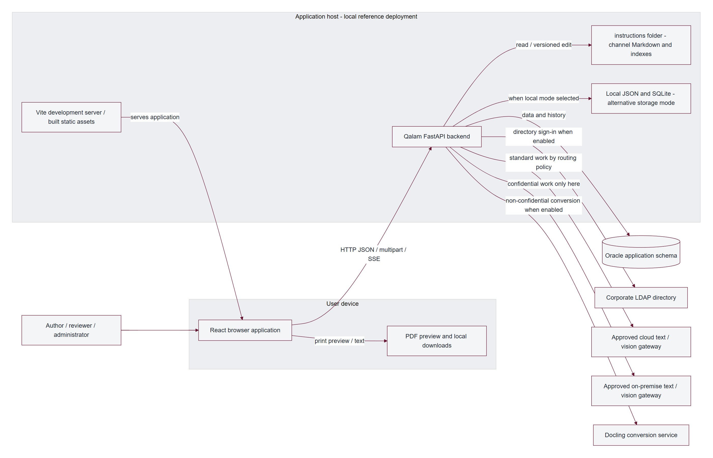
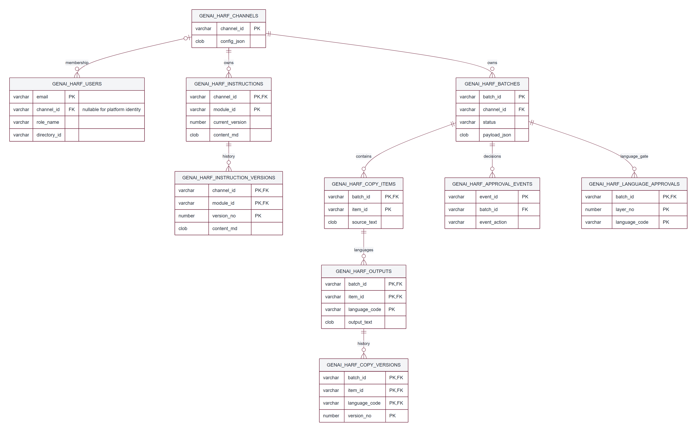
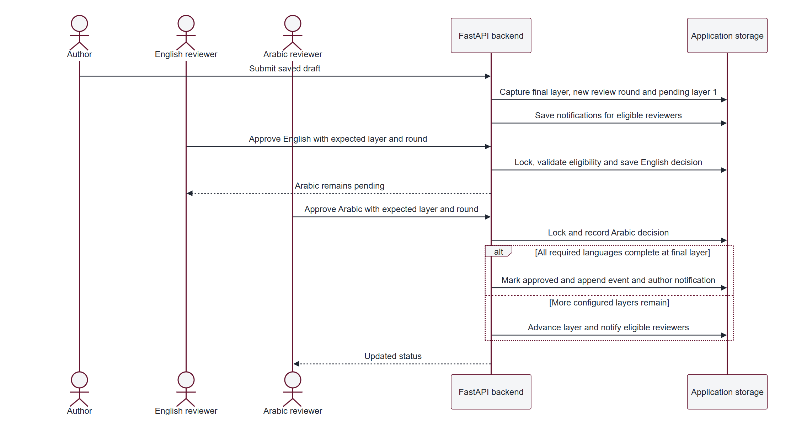

# Harf Technical and Operations Guide

Version 1.0 | 4 November 2026 | Technical review draft

Harf is a multilingual content application for business writing, customer communications and regulatory compliance. This guide explains how the application works, what infrastructure it needs, how to estimate AI consumption, and how to deploy, operate and validate it. It is intended for application owners, IT infrastructure teams, developers, security reviewers and support teams.

The current architecture uses external AI endpoints. A practical starting point for a pilot application server is 4 vCPU, 16 GB RAM and 100 GB SSD, with Oracle and AI services hosted separately. This is an engineering planning estimate, not a measured minimum or a throughput commitment. The application server requires no GPU for its current gateway-based architecture. Hosting an LLM internally is a separate infrastructure decision.

## 1 Document scope and evidence

This guide describes the inspected working tree, including the recent multilingual upload improvements. Some changes are not yet committed. Configuration examples describe supported settings; private environment files, database content and credentials were not inspected for this guide. No live directory, model, OCR or database connectivity test forms part of this documentation exercise.

Statements labelled Current describe code behaviour. Planning estimates require benchmarking. Proposed items describe deployment work still required. Historical test results are evidence of an earlier run, not certification of the present working tree.

The companion Solution Design Document contains the detailed route inventory, database relationships, design decisions and recorded risks. This guide adds infrastructure sizing, token accounting, deployment, operational procedures and handover criteria. Neither document replaces executable SQL or the application's access-control implementation.

## 2 Product capabilities and workflows

Authors can write, improve, review and translate content using typed text or uploaded briefs. They can select multiple components or templates, enter additional requirements, enhance those requirements with AI, edit rendered output, save batches, submit for approval and export content. English, Arabic or both are supported.

Each business channel has independent instructions and membership. Existing channels cover B2B, B2C, Regulatory Compliance and CX Comms. B2B includes website components and Google Paid Search. Regulatory Compliance turns source policies into concise memo outputs. New channels start with neutral instructions rather than inheriting another channel's rules.

| Workflow | Main stages | Important boundary |
| --- | --- | --- |
| Single copy | Brief, instructions, generation, editing, optional check, export | One user action can produce several model calls |
| Multiple components | Select formats, retrieve applicable rules, generate in order, validate | Every selected format has separate constraints |
| Bulk files | Upload or import rows, generate outputs, save batch, review | Larger file limits also increase AI work and memory demand |
| Approval | Submit, review required languages, advance layer, final decision | A bilingual layer requires English and Arabic approval |
| Instruction maintenance | Edit Markdown, confirm version, inspect history or restore | A restore creates a new version |
| Feedback | Thumbs up or down with reason for negative feedback | Context is visible to the relevant channel administrators |

## 3 Architecture and processing boundaries

The React interface runs in the user's browser. Vite builds static frontend assets; its development server is not the production hosting design. FastAPI exposes application APIs for writing, extraction, exports, approvals, administration and activity. The backend performs retrieval, validation and routing before contacting configured model endpoints.

| Layer | Current technology | Resource responsibility |
| --- | --- | --- |
| Browser | React 19, React Router, CSS, Lucide icons | Rendering, editing, local interaction and PDF preview |
| Build tool | Vite 8 and Node tooling | Build assets during delivery; no LLM inference |
| Application | Python, FastAPI, Uvicorn, Pydantic | API handling, orchestration, extraction, exports and validation |
| AI connectivity | OpenAI Python SDK and HTTPX | Calls remote approved gateways |
| Cloud model gateway | Responses API | Model inference runs on provider infrastructure |
| Internal model gateway | Chat Completions | Model inference runs on an independently operated internal service |
| Document service | Optional remote Docling | Conversion and OCR resources belong to its service host |
| Persistence | Oracle through python-oracledb; explicit local mode | Application data, versions, workflow and usage records |
| Identity | Optional LDAPS | Directory authentication; application manages roles |

There is no local LLM training pipeline, embedding service, vector database or autonomous model tool-calling framework in the inspected application. Application functions orchestrate the workflow directly. Indexed instruction retrieval is lexical and structured.

## 4 Hardware sizing for Harf

### 4.1 Application server planning profiles

The following profiles assume remote model inference and a separate Oracle service. CPU figures are virtual cores; RAM is system memory. Disk figures are initial allocations for the application, temporary work, logs and deployment headroom, excluding Oracle datafiles, model weights and backup repositories.

| Profile | CPU | RAM | SSD allocation | GPU | Intended use |
| --- | --- | --- | --- | --- | --- |
| Developer workstation | 4 to 8 modern cores | 16 GB; 32 GB if Oracle also runs locally | 50 to 100 GB free | None | Browser, frontend build, backend and small tests |
| Small pilot server | 4 vCPU | 16 GB | 100 GB | None | Controlled pilot with modest concurrent generation and occasional OCR |
| OCR and bulk focused pilot | 8 vCPU | 32 GB | 150 to 200 GB | None for remote OCR | More simultaneous document rendering and exports |
| Initial production candidate | 8 vCPU | 32 GB | 200 GB | None for remote inference | Starting point for load tests and operational hardening |

These are proposals, not validated user-count limits. The number of signed-in users is a weak sizing measure: ten people uploading scans can create more work than hundreds browsing saved copies. Measure active generation, scanned pages, exported file size and saved state volume.

CPU demand comes from PDF rendering, Unicode processing, tokenization, spreadsheet parsing, document creation and serialization. Most text generation time is spent waiting for the remote model or the rate limiter. Adding CPU cannot overcome a slow endpoint or a 50-attempt-per-minute cap.

### 4.2 Memory and temporary storage

A rendered page uses approximately width multiplied by height multiplied by bytes per pixel, before library copies. A 2600 by 1840 RGB image is about 14.4 MB in decimal units; a 3600 by 2545 RGB image is about 27.5 MB. Encoded PNGs may be smaller, but decompression, crops, base64, request objects and native-library buffers can coexist. Base64 adds approximately one third to encoded byte length.

Uploads are read into memory within configured size limits. An upload limit is not the peak RAM required to process it. DOCX and XLSX are compressed containers, and parsed content can occupy much more memory than the uploaded file. Concurrent exports and process-local caches add further demand.

Size RAM from measured peak resident memory plus OS and operational headroom. Investigate sustained memory use above 75 percent, repeated swapping, or growth that does not settle after jobs complete. These are suggested operating thresholds, not existing application alerts.

Temporary storage should be restricted, monitored and cleaned. Production browser-generated PDF files may reside on user devices. Define whether application-server temporary files require encryption, how long failed conversions remain, and who can access them.

### 4.3 Oracle and Docling hosts

Oracle must be sized by the DBA using the selected Oracle edition, supported OS, backup strategy and measured state growth. For a small separate database pilot, reserve a planning envelope of 4 vCPU, 16 GB RAM and at least 100 GB SSD, then validate against Oracle requirements and the actual workload. This is not an Oracle vendor minimum. A local database sharing the developer PC needs additional RAM and disk.

A separately hosted Docling pilot can start with 4 to 8 vCPU and 16 to 32 GB RAM, subject to its pipeline, OCR engine and document concurrency. GPU acceleration depends on the selected OCR engine and installed libraries. Harf does not install or manage the Docling server. Docling supports explicit CPU and accelerator selection; Arabic language support must be verified for the deployed engine. See external references E1 and E2.

### 4.4 Hosting models internally

An internal gateway does not mean the Harf application machine hosts model weights. If the organisation provides the endpoint, its infrastructure team owns model-serving capacity. Harf only needs network access and approved settings.

For self-hosting, a first-order weights-only estimate is parameter count multiplied by bits per weight divided by eight. This excludes quantization metadata, temporary buffers, activations, KV cache, vision components and serving overhead.

| Illustrative model size | FP16 or BF16 weights | 8-bit weights | 4-bit weights |
| --- | --- | --- | --- |
| 8 billion parameters | 16 GB | 8 GB | 4 GB |
| 32 billion parameters | 64 GB | 32 GB | 16 GB |
| 70 billion parameters | 140 GB | 70 GB | 35 GB |

These decimal GB values are arithmetic lower bounds, not GPU purchase recommendations. A 24 GB GPU cannot be assumed to serve a model merely because its quantized weights fit. Context length and simultaneous sequences can consume substantial additional VRAM. Multi-GPU serving requires a supported inference engine and suitable interconnects. vLLM documents tensor and pipeline parallelism for scaling model serving; no such server is bundled with Harf. See E3.

Before selecting GPUs, confirm the exact model and licence, total parameters for mixture-of-experts models, precision, context, vision support, concurrent requests, latency targets and measured tokens per second. Active parameters alone do not represent all stored weights. Validate quantized Arabic and regulatory output quality before selecting a smaller deployment.

### 4.5 Power and facilities

No measured electrical consumption is available. CPU core counts do not establish watts, and GPU TDP is not total server draw. Obtain system-level measurements or vendor specifications for idle, normal and peak load, including CPUs, RAM, disks, NICs and cooling.

For illustration only, an average 0.3 kW server running continuously uses about 216 kWh in a 30-day month: 0.3 multiplied by 24 multiplied by 30. Facility energy is higher after cooling and power overhead. This is a calculation example, not Harf's measured consumption. IT should size PSU redundancy, UPS and cooling from the chosen hardware.

## 5 Network and software requirements

| Connection | Typical port | Requirement |
| --- | --- | --- |
| User to application entry point | HTTPS 443 proposed | Trusted TLS certificate and controlled ingress |
| Proxy to backend | 8000 local default | Private backend exposure; streaming support |
| Frontend development | 5173 or available Vite port | Development only |
| Application to AI gateways | HTTPS 443 | Approved DNS, certificates, authentication and outbound policy |
| Application to Docling | HTTPS 443 or approved service port | Only if enabled and permitted for the document classification |
| Application to LDAP | LDAPS 636 typical | Trusted CA chain and scoped service identity |
| Application to Oracle | TCP 1521 local example | IT-approved DSN, listener and transport security |

Corporate gateways may require VPN, private routing or a proxy. A configured URL does not establish reachability. Do not disable certificate validation to make an incorrect endpoint work. Validate DNS, TLS, authentication, protocol and model deployment separately.

Use a tested Python and Node runtime supported by the dependencies, and record exact patch versions in the deployment manifest. The repository contains dependency ranges and unpinned backend packages; reproducible release builds require a reviewed dependency snapshot. The current Python environment used during development is not a universal production compatibility guarantee.

The browser must support modern JavaScript, editing and print preview. Test the organisation's supported Edge or Chrome versions, keyboard navigation, Arabic direction and mixed-language tables. PDF output depends partly on the browser print engine.

## 6 Tokens and AI consumption

### 6.1 What the limits mean

A token is a unit used by a model to process text or other input. It is not equivalent to a word or character. Arabic and English can tokenize differently, and mixed-language content adds further variability. Do not use one universal words-to-tokens multiplier for forecasts.

| Control | Current behaviour | Owner |
| --- | --- | --- |
| Input token cap | Default 64,000; model-specific positive integer overrides | Super admin in Models and routing |
| Output token cap | Default model budget 4,096; model policy can change it | Super admin model policy |
| Provider context window | Model-specific combined capacity governed by provider | Model provider and infrastructure owner |
| Outbound request rate | Defaults to 50 attempts per rolling minute application-wide and per channel | Super admin request controls |
| Monthly request allocation | Logical application usage allocated to channels and users | Super admin and channel admin within scope |
| Monthly token budget | No current enforcing monthly token budget in inspected code | Usage reporting exists; do not represent it as a hard budget |

The application input cap does not enlarge the provider context window. As a planning constraint, prompt input plus output reservation plus applicable provider overhead must fit the actual model limit. Some models account for reasoning or image tokens differently; confirm the provider contract.

### 6.2 Input accounting and instruction reuse

For recognised models the preflight counter loads bundled local tokenizer vocabularies. Unknown models use a conservative UTF-8 byte estimate, which can substantially overestimate Arabic input. Message framing adds an allowance of 64 plus 12 per message. Each image part reserves 32,768 estimated input tokens; this is a local safety allowance, not its actual provider price or token count.

Input includes the brief, user instructions, selected system rules, format schema, terminology, message framing and repair context. General instructions are selected once within a logical generation request and reused across outputs. Applicable indexed components, templates and glossary rows are selected separately. Every required model call still receives its needed prompt. Reusing local retrieval does not mean the provider reads or bills those tokens only once.

Current retrieval uses indexes, component IDs, dependencies, lexical ranking and signature-based caches. It does not use embeddings or a vector database. File-selection caches improve local work; provider prompt caching is a separate capability and is not assumed in these estimates.

### 6.3 Illustrative consumption scenarios

All figures below are planning examples, not measured application averages. Token totals are sums across calls. Actual call paths can vary with selected language, model, repairs, segmentation, assessment and retries. Bilingual generation is not universally two independent calls.

| Scenario | Assumed calls | Total input tokens | Total output tokens | Combined tokens |
| --- | --- | --- | --- | --- |
| Short single-language copy | 1 at 3,000 input and 400 output | 3,000 | 400 | 3,400 |
| Short bilingual copy in one call | 1 at 3,500 input and 800 output | 3,500 | 800 | 4,300 |
| Ten components without repairs | 10 at 3,000 input and 400 output | 30,000 | 4,000 | 34,000 |
| Same set with three field repairs | Above plus 3 at 1,500 input and 150 output | 34,500 | 4,450 | 38,950 |
| Twenty imported rows in both languages | 20 at 3,000 input and 800 output | 60,000 | 16,000 | 76,000 |
| Segmented policy and final memo | 5 calls at 8,000 input and 700 output, then 1 at 6,000 and 1,500 | 46,000 | 5,000 | 51,000 |

Scanned documents require separate accounting. The scan path normally transcribes a page and independently checks its numeric readings; discrepancies can trigger rereads. For a hypothetical 10-page document averaging two OCR calls per page at 4,000 input and 600 output per call, OCR alone would total 80,000 input and 12,000 output tokens. Drafting the memo adds more. Actual vision accounting depends on images and the provider; the 32,768-per-image local allowance is deliberately different from this illustrative billed-usage assumption.

At 1,000 monthly short bilingual actions using the example above, the forecast is 3.5 million input and 0.8 million output tokens before checks, retries and other AI actions. At 1,000 monthly 20-row bilingual batches, it becomes 60 million input and 16 million output tokens under the stated assumptions. Reporting must distinguish user actions, generated outputs, outbound calls and tokens.

### 6.4 Cost estimation

Cost equals uncached input tokens divided by one million times the input rate, plus cached input tokens divided by one million times any applicable cached rate, plus output tokens divided by one million times the output rate, plus other applicable charges. Keep input and output separate because rates may differ. Do not use the combined token column as one billable rate.

For illustration, if a contracted model costs 2 currency units per million input tokens and 8 per million output tokens, the 1,000-action bilingual example costs 13.4 currency units: 3.5 times 2 plus 0.8 times 8. These are fictional rates, not Azure or internal gateway prices. Populate the workbook or reporting model with approved contracted prices, regional currency and any gateway, hosting, OCR and network costs.

Use provider-reported usage for financial reconciliation. Unknown or missing usage must remain unknown rather than becoming zero. Capture model, gateway, channel, operation, input tokens, output tokens and any cache/reasoning fields available from the provider, without storing unnecessary document content in operational logs.

## 7 Performance and capacity

Default 50 outbound attempts per minute is a shared application ceiling, not 50 completed documents per minute. Channel caps cannot increase the application ceiling. If each completed action requires an average of four calls, the theoretical rate-limited ceiling is 12.5 actions per minute before latency, failures or competing work. A 20-call batch consumes 40 percent of a 50-attempt minute before extra validation or retries.

Using Little's Law for planning, 0.833 calls per second at 15 seconds average call latency implies about 12.5 in-flight calls to sustain 50 calls per minute. This is arithmetic, not the application's supported concurrency. The code has narrower bounded execution paths, and different request types may compete.

| Resource control | Inspected implementation |
| --- | --- |
| Bulk generation slots | Two concurrent bulk executions per process |
| B2B multi-output executor | Two worker threads for independent selected jobs, saved in selection order |
| OCR document slots | Two concurrent OCR documents per process |
| OCR page parallelism | Up to two page jobs; PDFium rendering is serialized |
| Rate-limit waiters | Eight waiting calls per process |
| Rate-limit maximum wait | Default 120 seconds |
| Oracle connection pool | Minimum 1, maximum 6 per process; 10-second pool wait and TCP connect settings |
| Oracle statement timeout | 30 seconds in the inspected runtime adapter |

Do not multiply Uvicorn workers without reviewing storage synchronization, local managed environment files, caches, retention jobs and global limits. The application has no durable distributed generation queue or replay worker. More processes also multiply pools and process-local semaphores. Horizontal scaling requires a design review rather than a worker-count change alone.

Benchmark a workload mix rather than just a health endpoint. Record p50 and p95 time to first text, total generation time, rate wait, extraction time per page, export time, CPU, peak resident memory, database latency and error rate. Agree acceptance values with the business before testing. No p95 latency or user-capacity guarantee is established by this guide.

## 8 Files OCR and multilingual behaviour

| Format | Reader path | Coverage and limitations |
| --- | --- | --- |
| DOCX | Local OOXML reader or enabled Docling service | Local reader includes main text, tables, nested tables, text boxes, headers, footers, footnotes and endnotes; image-only words are not automatically OCRed inside Word |
| PDF with text | PDF text extraction or Docling | Reading order and complex columns depend on the source; broken embedded fonts need validation |
| Scanned or mixed PDF | Page inventory and image-reading OCR path | Reads source language and checks numeric consistency; unresolved disagreement stops the upload |
| PNG JPG WebP screenshots | Approved image-reading model | Preserves Arabic and English text; image quality remains important |
| TXT and supported plain text | Strict UTF-8 or BOM-marked UTF-16 | Unsupported encodings fail rather than silently replacing characters |
| XLSX and CSV | Spreadsheet import workflow | Select worksheet and message columns; source ID and metadata can accompany each row |

Current upload size bounds are 50 MB for Regulatory Compliance and 10 MB for other channels. Regulatory Compliance allows up to two million extracted characters. This extraction allowance is not a promise that two million characters can enter one model request. Channel bulk limits are configurable, and spreadsheet imports also have their own row, column and expanded-archive safeguards.

The scan limit defaults to 50 scanned pages, with a 900-second document timeout. Native text pages do not count towards that OCR-page limit. Dense pages, missing vision approval, timeouts or unresolved numeric disagreement can fail the upload. The application should not return a successful partial source when a scanned page fails.

Docling is optional. When DOCLING_ENABLED is false or absent, supported files use their direct paths. When enabled, PDF and DOCX can use the service, but scanned PDFs may be handled by the application's own OCR first. Confidential documents bypass external Docling. DOCLING_DO_OCR controls Docling OCR; it is not the master switch for all document reading.

The recent local extraction improvements have four targeted passing tests. Earlier broad regression evidence does not validate these new changes. The previously reported Arabic page-4 numeric disagreement was not reproduced or resolved by writing this guide. Use a representative Arabic/English acceptance corpus before release.

## 9 Data storage and lifecycle

Oracle uses 19 application and support tables with the GENAI_HARF_ prefix. The existing application owner remains REWRITE_APP as a compatibility identity. The runtime holds an aggregate JSON state together with relational projections; do not assume every operation is a small independent row update. Growing saved histories can increase serialization, contention and database storage.

| Data group | Contents |
| --- | --- |
| Channels and users | Channel setup, role, membership, review assignments and directory identity |
| Instructions and versions | Current Markdown, historical text, author, time, note and restore reference |
| Batches items and outputs | Source, user requirements, generated English/Arabic, versions and quality details |
| Approval evidence | Language decisions, layers, notes, timestamps and historical events |
| Activity notifications feedback | Operational actions, inbox events and feedback snapshots |
| Limits and usage | Monthly reservations and allocations, model policy and usage aggregates |
| Schema and runtime support | Installation history, migration snapshots and aggregate runtime state |

The baseline Oracle scripts require Oracle 19c or newer and AL32UTF8 storage. Source SQL is authoritative for constraints, indexes and views. SQL Developer is a client; its connection label is not the database service or schema name. The local FREEPDB1 service and REWRITE_APP user are examples, not production mandates.

The bootstrap schema quota was 250 MB. A later historical write test reported ORA-01536 quota exhaustion. Do not infer current health from a prior migration success. A DBA must check actual usage and grants; application users cannot grant themselves quota. The repository provides a reviewed local quota-increase script.

Estimate storage as saved source and output bytes plus every retained version, instruction history, aggregate-state duplication, relational projections, indexes, backups and recovery overhead. For example, 10,000 records at an assumed 30 KB source plus 20 KB bilingual output equal approximately 500 MB of text before history, projections or overhead. This is illustrative; measure database segments and actual encoded payloads before forecasting.

Original uploaded file bytes are not durably archived in the inspected upload path. Extracted text and metadata are saved with work. If legal or operational requirements need the original PDF, image or Word file, add controlled document storage with encryption, access checks, retention and integrity references.

Operational-log retention defaults to 180 days and can be changed by the super admin within 31 to 3,650 days. Cleanup is selective: it preserves saved content, approval evidence, feedback and instruction versions. It is not a universal deletion policy for all personal or customer data. Define a separate approved lifecycle for persistent content and backups.

## 10 Identity permissions and approvals

| Role | Main scope |
| --- | --- |
| User | Own authorized writing, saved work and workflow actions |
| Reviewer | Assigned channel, review layer and language; permitted submitted context |
| Channel admin | Own channel users, instructions, allocations, feedback and workflow administration |
| Super admin | Channels, global controls, models, allocations, aggregate visibility and instruction access |

Super-admin management visibility does not grant access to other users' content or permission to approve their work. Channel-scoped content operations must remain authorized on the backend, even if an interface control is hidden.

LDAPS validates directory credentials and records a stable directory identity. Directory membership does not automatically assign a business channel or reviewer role. Administrators explicitly allocate access. DEVELOPER_MODE=true selects local authentication and must be disabled for a corporate deployment. AUTH_PROVIDER=ldap selects directory mode when developer mode is off; compatibility names are also accepted.

The current local development path accepts identity headers and uses a simple SHA-256 password hash. It requires hardening before wider deployment. The LDAP session format is a custom signed token, despite JWT-named settings; it is not a standard three-part JWT. Security review must cover session expiry, secret rotation, logout, identity spoofing and the ingress trust boundary.

Multiple eligible reviewers can receive the same layer's work. One approval per required language is sufficient for that layer. If both English and Arabic are required, both languages must complete before progression. A reviewer assigned both languages may approve both. The configured final layer can be earlier than layer three. Changes to routing invalidate incompatible decisions through a new review round; stale actions must conflict rather than silently overwrite newer state.

## 11 Configuration reference

Configuration must be managed through approved deployment secrets and settings. Never copy real keys or passwords into this guide, tickets, source control or presentation material. The table lists setting names and meanings, not live values.

| Group | Important variables | Notes |
| --- | --- | --- |
| Inference mode | MODEL_PROVIDER, INFERENCE_CONNECTION_SOURCE | live enables routing; mock blocks live inference; connections remain environment-owned |
| Cloud gateway | APIM_BASE_URL, APIM_API_TYPE, APIM_API_STYLE, APIM_API_VERSION, APIM_AUTH_HEADER, APIM_API_KEY | Responses route with approved endpoint shape |
| Internal gateway | LITELLM_BASE_URL, LITELLM_API_TYPE, LITELLM_API_KEY | Chat Completions route; model inventory is separate |
| Model inventory | AZURE_EXPLICIT_DEPLOYMENTS, ON_PREM_EXPLICIT_MODELS, INFERENCE_CATALOG_ENV_FILE | Configured inventory is not proof of availability |
| Token controls | DEFAULT_MAX_INPUT_TOKENS, LLM_MODEL_INPUT_TOKEN_LIMITS, DEFAULT_MAX_TOKENS | Per-model policy and managed overrides apply |
| Rate controls | LLM_REQUESTS_PER_MINUTE, LLM_CHANNEL_REQUESTS_PER_MINUTE, LLM_CHANNEL_RATE_LIMITS, LLM_RATE_LIMIT_MAX_WAIT_SECONDS | Shared attempt capacity and bounded wait |
| Retention | USER_LOG_RETENTION_DAYS, PLATFORM_POLICY_ENV_FILE | Managed policy file can override bootstrap values |
| Docling | DOCLING_ENABLED, DOCLING_BASE_URL, DOCLING_DO_OCR, DOCLING_OCR_LANGUAGES, DOCLING_OCR_PRESET | Engine and language compatibility require service verification |
| Scan controls | SCAN_OCR_FALLBACK_ENABLED, SCAN_OCR_MAX_PAGES, SCAN_OCR_TIMEOUT_S | Native PDF path also has direct scan handling after recent changes |
| Storage | REWRITE_STORAGE_BACKEND, ORACLE_USER, ORACLE_PASSWORD, ORACLE_DSN | local or oracle is explicit; Oracle failure does not fall back silently |
| Authentication | AUTH_PROVIDER, DEVELOPER_MODE, JWT_SECRET, JWT_EXPIRY_HOURS | Retained names are compatibility settings |
| Directory | LDAP_SERVER, LDAP_PORT, LDAP_BASE_DN, LDAP_BIND_DN, LDAP_BIND_PASSWORD, LDAP_USER_SEARCH_BASE, LDAP_USER_SEARCH_FILTER | Validate LDAPS certificate and attribute mapping with IT |

See backend/inference.env.example, backend/docling.env.example, backend/llm-rate.env.example, backend/platform-policy.env.example and backend/oracle.env.example. Some comments in older examples are stale, including an old numeric range for input caps; runtime validation and current admin models are authoritative. Most connection-secret changes require a backend restart. Managed model/input/rate controls have explicit reread paths; do not assume every environment change is live.

## 12 Deployment and release procedure

1. Agree pilot scope, user groups, approved models, classification rules, quality criteria and infrastructure ownership.
2. Record the release commit, uncommitted-change status, Python and Node versions, dependency snapshot and configuration names.
3. Provision separate application, Oracle and optional document/model services with approved network paths and secrets.
4. Use a dedicated Oracle application schema. Apply the repository migration sequence appropriate to the current installation; do not rerun baseline scripts on an existing database.
5. Follow the migration runbook for backup, pause, import, count/content verification, cutover and rollback. Confirm the target service and active table prefix before any DDL.
6. Install backend dependencies in an isolated environment. Build frontend assets using npm ci and npm run build with the reviewed lockfile.
7. Serve static assets behind the approved HTTPS entry point and proxy API paths to the supervised backend. The current main.py launcher binds to loopback port 8000.
8. Preserve streaming responses through the proxy; validate idle/read timeouts against generation and scan operations. Disable inappropriate response buffering for streams.
9. Enable corporate authentication, disable developer mode, restrict CORS and review session/certificate settings.
10. Execute acceptance tests with synthetic and approved documents, verify storage writes and rollback readiness, then conduct the controlled pilot.

There is no supplied production topology, container orchestration standard, distributed job queue or service-level agreement established by the local launcher. IT must define process supervision, restart policy, reverse proxy, certificates, health probes and maintenance responsibility.

## 13 Security and confidentiality

Confidential generation must resolve to an enabled approved on-premise model. Missing or unsuitable internal capacity must fail closed. External Docling is bypassed for confidential uploads. Scanned confidential files require an approved internal image-reading model; a text-only model cannot OCR them.

Review every outbound path: extraction, image reading, generation, repair, analysis, instruction enhancement and assessment. Confirm that each respects classification and model policy. Endpoint configuration alone cannot prove the gateway's downstream routing or data-residency commitments.

Production requirements include trusted TLS, protected secrets, scoped network rules, strict browser origins, reviewed identity enforcement, restricted service accounts, dependency scanning, backup encryption and content-safe logging. Current wildcard CORS and local authentication assumptions require explicit remediation before broad access.

Uploaded documents are untrusted source data. Instructions printed inside them must not override application rules. Numeric accuracy checks and format validation reduce specific risks but do not guarantee correctness, legal compliance or factual completeness. Users and reviewers retain responsibility for publication decisions.

## 14 Monitoring support and recovery

| Signal | Why it matters | Suggested response |
| --- | --- | --- |
| Storage health and verified write | A read-only probe cannot detect all quota or write failures | Alert on failed controlled writes and investigate Oracle error code |
| Provider error and rate wait | Explains generation delay and interrupted output | Inspect model/gateway health, attempt usage and timeout |
| CPU memory and temporary disk | Detects heavy extraction or exhausted host capacity | Reduce concurrent work or scale after measurement |
| OCR failure by page and language | Exposes poor scans and engine/language problems | Review source and service configuration; preserve uncertainty checks |
| Token usage by model and operation | Supports cost forecasting and runaway-use detection | Reconcile provider usage and investigate repeated repairs |
| Database growth and lock time | Aggregate-state persistence can bottleneck | Review segment usage, state size, transactions and query traces |
| Backup completion and restore tests | A successful backup alone does not establish recoverability | Schedule isolated restore drills and record evidence |

The storage health route checks runtime-state availability. Add a controlled synthetic read/write/delete check in a dedicated test scope for release readiness, with authorised data cleanup. Do not place customer content in health checks or expose diagnostic details publicly.

Back up Oracle consistently, managed policy files, instruction files and history, release assets and required secret references. Original local backup files are rollback evidence, not an ongoing enterprise backup solution. Define RPO and RTO with the owner; neither is presently verified. A proposed pilot objective could be RPO 24 hours and RTO 4 hours, but it becomes a commitment only after approval and a successful restore drill.

Rollback must reconcile new writes. Switching to an old local data store after users have created Oracle work can lose or fork records. Pause writes, preserve the failed state, validate recovery and follow the repository cutover/recovery procedure. Never drop or rename live tables merely to clear an error.

### 14.1 Common support cases

| Symptom | Likely checks |
| --- | --- |
| Application storage unavailable | Service reachability, schema access, migrations, quota and actual write result |
| ORA-01536 | DBA checks tablespace quota and usage; repeated user retries do not increase quota |
| Generation interrupted | Sanitized reference log, gateway response, model route, input cap and timeout |
| Too many requests | Application and channel attempt caps, provider quota, repairs and OCR competition |
| Arabic numeric disagreement | Source scan, independent readings, correct vision model and OCR settings |
| Excel output appears incomplete | Export includes full cell text, wrapping, row height and spreadsheet display limits |
| Confidential upload rejected | Enabled internal model, vision approval if required, trusted route and input cap |
| Approval cannot advance | Required languages, current layer/round, reviewer assignment and final-layer policy |

## 15 Validation and acceptance plan

The earlier recorded regression reported 497 backend and 55 frontend tests passing, plus 30 approval scenarios. Those historical results also recorded an Oracle quota failure and an unresolved Arabic numeric scan case. The recent extraction change has four passing targeted tests; the broader run was interrupted. No new full regression, live provider benchmark or infrastructure qualification was performed for this guide.

| Test area | Required evidence before release |
| --- | --- |
| Content quality | Business-approved examples, Arabic and English rubric, mandatory facts, claims, terminology and format limits |
| Channel isolation | Users cannot access another channel through UI, direct API or guessed identifiers |
| Reviewer privacy | Reviewers see submitted context in scope and cannot browse unrelated activity or instruction editing |
| Confidential routing | Every relevant call stays on approved internal services; outage never falls back to cloud |
| Upload completeness | Arabic and English native PDFs, scans, mixed pages, Word stories, screenshots and spreadsheets |
| Components and templates | All 17 B2B formats, single and multi-selection, both languages, repairs and future-schema additions |
| Approvals | Same-language races, separate language reviewers, changed final layer, returns, rejections and stale rounds |
| Exports | DOCX PDF TXT XLSX, long content, RTL, mixed tables, full spreadsheet cells and scores |
| Capacity | Agreed workload mix at increasing concurrency with latency, RAM and failure measurements |
| Persistence and recovery | Read and write, quota failure, restart, backup restore, migration rollback and record reconciliation |
| Security | Auth enforcement, TLS, CORS, secret handling, dependency review and access audit |

Quality scoring is advisory and can include AI judgement or partial assessment. A high score is not proof that every source fact was preserved. Acceptance should combine deterministic checks and human review of representative outputs. Define blocking defects, review sample sizes and sign-off owners before the pilot.

## 16 Ownership and handover

The business owner approves tone, examples, permitted claims, templates and acceptance criteria. Channel administrators maintain instructions, membership and reviewer assignments. The application team owns code, releases and incident investigation. Infrastructure owns compute, TLS, network routes and supervision. The DBA owns database capacity, backup and privileges. Identity and AI platform teams own directory and gateway services respectively. Security approves classification, residency, retention and production controls.

The handover pack should contain the release commit and build instructions, infrastructure inventory, approved environment-variable inventory without secrets, architecture and data diagrams, migration and restore evidence, dependency snapshot, test results, channel-owner list, quality rubric, operational dashboards, escalation contacts and known limitations. Ownership names and support hours remain to be agreed.

## 17 Technical vocabulary

| Term | Practical meaning in Harf |
| --- | --- |
| vCPU | A virtual CPU core allocated to a server |
| RAM | Working memory used by the application and document processing |
| GPU and VRAM | Accelerator and its dedicated memory; needed for an independently hosted model, not ordinary remote API calls |
| Context window | The selected model's supported request capacity, subject to provider accounting |
| RPM | Outbound request attempts per minute; separate from monthly logical request allocations |
| KV cache | Model-serving memory retaining attention state; grows with context and concurrent sequences |
| OCR | Reading text from page images or screenshots |
| RAG | Retrieval augmented generation; Harf currently retrieves indexed instructions without a vector store |
| SSE | A streaming HTTP response delivering generated text progressively |
| Schema | Database objects owned by an application database user |
| RPO and RTO | Permitted data loss interval and target recovery duration |
| p95 latency | Time within which 95 percent of measured operations finish |

## 18 Sources and maintenance

### 18.1 Application evidence map

| Source | What it establishes |
| --- | --- |
| package.json and package-lock.json | Frontend dependencies and build scripts |
| backend/requirements.txt | Backend dependency names and ranges |
| backend/main.py | API registration, CORS, local listener and storage health |
| backend/inference.py and inference_admin.py | Gateway routing, model policy and confidentiality |
| backend/input_tokens.py and platform_policy.py | Input accounting, model overrides and retention |
| backend/llm_rate_limits.py | Attempt limits, waiting and managed settings |
| backend/generation_context.py, structure_retrieval.py, terminology_index.py | Request-scoped reuse and indexed instruction selection |
| backend/ai_service.py, document_text.py, scan_ocr.py, docling_client.py | Extraction, multilingual handling and OCR routing |
| backend/spreadsheet_import.py and copy_export.py | Import/export structure and safeguards |
| backend/approval.py and approval_policy.py | Batch concurrency, language decisions and workflow policy |
| backend/directory_auth.py and access_control.py | Identity and role boundaries |
| backend/oracle_runtime.py and database/oracle | Pool behaviour, persistence and schema procedures |
| SDD/Harf_Solution_Design_Document.md | Detailed current design and historical evidence boundaries |

### 18.2 External references

- E1 Docling accelerator configuration: https://docling-project.github.io/docling/_generated/examples/run_with_accelerator/
- E2 Docling OCR options and supported pipeline configuration: https://docling-project.github.io/docling/reference/pipeline_options/
- E3 vLLM parallelism and scaling: https://docs.vllm.ai/en/stable/serving/parallelism_scaling/

External references were checked on 4 November 2026. They describe those upstream projects, not installed Harf infrastructure or guaranteed service capabilities. Hardware and consumption examples in this guide are engineering estimates with explicit assumptions.

Update this guide when models, limits, storage behaviour, deployment topology, permissions or channel workflows change. Keep a version, date, change summary and reviewer for each approved revision. Re-run representative measurements after major model or document-processing changes.
