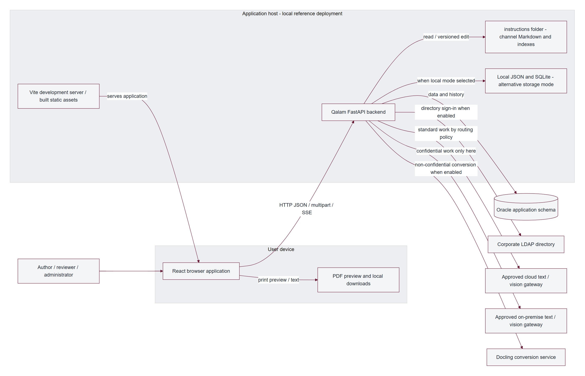
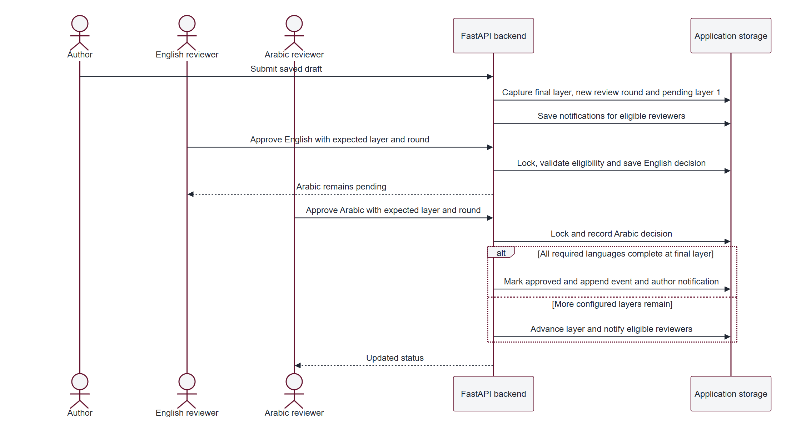

# Harf VP Presentation Briefing

Meeting preparation for 5 November 2026 | Prepared 4 November 2026

Harf is a governed AI content workspace. It brings writing, document understanding, bilingual output, channel-specific instructions, review and export into one controlled workflow. Its value proposition is faster preparation of consistent content with accountable human review. Content quality and time savings must be established through a measured pilot before a broad rollout commitment.

This briefing reflects inspected application code and recent working-tree changes. It does not certify live endpoints, production security, measured capacity or business acceptance. The accompanying technical guide provides infrastructure planning; the Solution Design Document provides deeper implementation detail.

## 1 The opening message

“Harf helps teams turn briefs and existing documents into structured, bilingual content using the instructions approved for their business area. It brings generation, editing, review and export into one workspace. The AI drafts and checks; people retain control of instructions, approvals and publication. Our proposed next step is a controlled pilot to measure content quality, editing effort and turnaround time against agreed acceptance criteria.”

Use this as the opening, then show one successful end-to-end example. Lead with the business task and the resulting content before discussing frameworks or infrastructure.

## 2 A clear presentation structure

| Segment | What to show or say | Suggested time |
| --- | --- | --- |
| Business need | Teams need consistent content across different formats, languages and policy requirements | 1 minute |
| Product | One brief to governed draft, edit, review and export | 2 minutes |
| Demonstration | A prepared brief, selected format, bilingual output and review context | 3 minutes |
| Architecture and control | Channel instructions, model routing, confidential boundary and Oracle storage | 2 minutes |
| Readiness and decision | Known limits, measurable pilot and ownership | 2 minutes |

For a shorter meeting, keep the opening, one demonstration, the confidentiality boundary and the pilot decision. Keep detailed questions in reserve.

## 3 What Harf solves

Harf supports different content tasks without forcing every business area to use the same writing rules. B2B can use website components and paid-search formats. B2C and CX Comms can use their communication templates and glossary rules. Regulatory Compliance can summarise a source policy into a memo. Each channel has its own membership and instructions.

The intended benefits are reduced drafting effort, easier access to approved guidance, consistent formats and a traceable review process. These are expected benefits. A production claim such as “reduces work by 60 percent” requires measured evidence and should not be used yet.

| Capability | Business significance |
| --- | --- |
| English and Arabic | Supports multilingual communications and language-specific review |
| Channel instructions | Applies the relevant writing rules and terminology |
| Multiple components and bulk inputs | Produces several requested formats within a workflow |
| Editable output | Lets the author improve the draft in place |
| Approval routing | Records decisions, notes, language and review progression |
| Instruction versioning | Makes policy changes accountable and reversible |
| Feedback | Gives the relevant administrators examples to improve instructions |
| Model and request controls | Makes AI access and consumption administratively manageable |

## 4 Architecture in business language

“The user works in a browser. The application checks access, selects the appropriate instructions and sends the request to an approved AI endpoint. It validates and displays the result, and saves the workflow in Oracle. Document extraction and the model itself are separate services or processing paths.”

| Part | Technology | What it does |
| --- | --- | --- |
| User interface | React 19, React Router, CSS, Lucide icons | Writing workspace, admin screens, editing, review and interaction |
| Frontend build | Vite 8 | Packages the interface for delivery |
| Application backend | Python, FastAPI, Uvicorn, Pydantic | Receives requests, enforces access, coordinates processing and validates data |
| Model connection | OpenAI Python SDK through a routing adapter | Connects to supported approved model endpoints |
| Cloud gateway | Responses API | Carries standard authorised AI requests to a configured cloud deployment |
| Internal gateway | Chat Completions API | Carries requests to an independently managed internal model service |
| Database | Oracle through python-oracledb | Stores users, instructions, saved work, review events and operational records |
| Document conversion | pypdf, PDFium, Python DOCX/OOXML processing, optional Docling | Extracts content from supported uploaded files |
| Spreadsheets | openpyxl and CSV processing | Imports rows and builds Excel exports |
| Directory authentication | ldap3 over LDAPS | Connects to the corporate directory when configured |

An API is a controlled interface between systems. A gateway is the endpoint through which the application reaches a model. An LLM is the language model that produces or evaluates text. Oracle is the database; SQL Developer is a tool used to administer it.

### 4.1 Connection map

The browser connects to the application. The backend connects separately to Oracle, the selected model gateway, optional Docling and the directory. A production deployment should expose a controlled HTTPS entry point and keep internal services appropriately restricted. The inspected launcher is a local development server; it is not a completed production network design.

Typical ports are HTTPS 443 for approved web endpoints, LDAPS 636 and Oracle 1521 in the local example. The backend uses loopback port 8000 locally. Actual deployment addresses, VPN requirements, certificates and service ownership must be confirmed by IT.

## 5 How a generation request works

1. The author provides text or a brief, selects formats and languages, and enters any additional requirements.
2. The backend checks the user's channel access, request allowance and document classification.
3. File processing extracts source text when required. Scanned pages may need OCR and independent numeric checks.
4. Retrieval selects the relevant general rules, indexed templates or components and glossary content.
5. Routing resolves the channel/default model or the mandatory internal route for confidential work.
6. Input-token and attempt limits are checked before model submission. The model creates the content using the supplied context.
7. Application checks validate supported constraints. Some outputs use bounded model repairs. The interface displays or streams the result for editing.
8. The user can request a quality check, save, export or submit for human approval. Workflow events are persisted.

One click can involve multiple calls: extraction, segmented source analysis, generation, field repair and optional assessment. A large bilingual batch is not equivalent to one short prompt in cost or latency.

## 6 Which features use which AI or technology

The local copywriter configuration specifies gpt-5.1 and leaves MODEL_PROVIDER blank, selecting the legacy Azure path for ordinary requests unless the running environment overrides it. The newer live routing path uses environment configuration and administrator policy. Section 17 records the subsequent configuration inspection and its limits. A model shown in a catalog is not proof that its endpoint is available or validated.

In the live route, ordinary features use the channel-assigned model where present, otherwise the default model. Confidential features use the designated enabled on-premise model with no cloud fallback. Vision requests additionally require a vision-approved model. The configured endpoint's operator remains responsible for the actual hosted model and downstream processing.

| Feature | AI or deterministic processing | Model selection or technology |
| --- | --- | --- |
| Write or improve | LLM generates wording | Channel/default text route; internal route for confidential work |
| Translation and bilingual copy | LLM generation with meaning-based language instructions | Same routing policy; no dedicated fixed Arabic model |
| B2B components | Indexed schema plus structured LLM output and local validation | Same text route; bounded repairs may create extra calls |
| Multi-component flow | Ordered generation and applicable set review | Local orchestration plus LLM-assisted checks where invoked |
| Regulatory memo | Source segmentation, evidence gathering and LLM drafting | Selected text route; marked confidential uses internal model |
| Bulk generation | Application schedules jobs and repeats generation | Text route reused under the request context; two-thread B2B execution path |
| Instruction retrieval | Deterministic indexed and lexical selection | Python indexes and caches; no embedding model required |
| Glossary selection | Indexed matching and rule selection | Python terminology index; the LLM receives selected rules |
| Context detection | LLM-assisted structured classification | Text route; this is not an independently trained classifier |
| Component matching | Pattern/index-based detection and schema lookup | Local application logic for component identifiers and matching |
| Additional-instruction enhancement | LLM rewrites the author's requirements | Text route; user reviews before applying |
| Admin Markdown helper | LLM proposes instruction wording and placement | Text route plus indexed section context; admin applies the edit |
| Guideline and source assessment | LLM judgement plus local factual, numeric and format checks | Text route with referenced instruction sections and assessment caches |
| Character counts | Deterministic counting | Interface/backend logic; no LLM needed |
| Native Word/text extraction | Document parsing | Local OOXML and text readers, or optional Docling for DOCX |
| Text-based PDF extraction | Document parsing | pypdf or optional Docling; source layout may affect reading order |
| Scanned PDFs | Vision LLM transcription and independent numeric reading | Vision-approved route; confidential scans require internal vision support |
| Screenshots | Vision LLM reads visible text | Vision-approved route; source language is preserved |
| Docling conversion | External document-processing pipeline if enabled | Service-owned OCR/layout engines; not necessarily the writing model |
| Excel/CSV input | Deterministic row and column import | openpyxl and CSV; imported text is then passed to generation |
| DOCX and XLSX export | Deterministic document creation | python-docx and openpyxl; scores can require AI assessment separately |
| PDF/TXT export | Browser print/preview and text output | No LLM needed to render an existing result |
| Approvals and permissions | Deterministic workflow and authorization | Application logic and Oracle; people make approval decisions |
| Notifications and feedback | Application records and scoped visibility | No autonomous model learning |
| Dashboard summaries | Aggregation of recorded events | Application calculations; hours saved is an estimate |

The legacy Azure adapter remains available when live routing is not selected. Mock mode disables live AI calls rather than proving a working offline LLM. Explain the live architecture during the presentation and confirm the actual selected mode before demonstrating.

## 7 Instructions and accuracy

“We give the model the relevant approved rules rather than treating it as a generic copywriter. General rules are selected once for the logical request, with indexed format and glossary selection for each output. We then validate supported constraints and keep a human review step.”

The channel instruction pack separates system rules, indexed format/template rules and the user/admin guide. The guide is for people and excluded from generation prompts. Admin edits create versions; restoring an older version creates another recorded version. Feedback does not automatically rewrite approved instructions.

The retrieval is structured and lexical, with component IDs, dependencies and bounded caches. It is not an embedding/vector RAG implementation. “STAIR-like” describes hierarchical selection informally; it should not be presented as a verified implementation of a specific research paper.

Selecting general instructions once saves local retrieval work, but each required model call still receives its applicable prompt. This does not establish provider prompt caching or eliminate repeated input tokens.

### 7.1 What the score means

Guideline strength and output assessment are advisory checks. The system combines deterministic evidence such as numbers, links and character limits with model judgement and references to selected rules. Some assessments may be partial. A score is not an independently measured probability of correctness or a guarantee that every source fact is retained.

For a VP, say “The score helps focus review. We will validate its usefulness against human ratings during the pilot.” Do not say “A 92 percent score proves 92 percent factual accuracy.”

## 8 Governance confidentiality and human approval

Business channels separate instructions, membership and authorized content. Authors see their permitted work. Reviewers operate within their assigned channel, layer and language. Channel admins manage their scope. Super admins manage global controls and aggregates, with instruction access, but are not granted visibility into other users' content or permission to approve it.

Multiple people may be eligible at one layer. One approval for each required language completes that layer. For bilingual work, English and Arabic both need approval before progression. One reviewer with both language assignments may supply both. The final layer is configurable, so three layers are not mandatory for every channel. State and review-round checks prevent stale decisions from silently replacing newer ones.

Confidential marking restricts the route to an approved enabled internal model and bypasses external Docling. If the model is unavailable, the request is blocked rather than moved to cloud. Image-only confidential sources require internal vision support. This is an application routing control, not proof of a gateway provider's infrastructure, data residency or contractual retention.

There is no automatic sensitivity classifier that can reliably identify all unmarked confidential information. Users need classification guidance, and infrastructure/security teams must verify the actual processing boundary.

## 9 Limitations and release position

| Area | Honest current position | Next evidence needed |
| --- | --- | --- |
| Content quality | Output may require editing; stakeholder acceptance is not established | Agreed rubric and representative human evaluation |
| Hallucination | Instructions and checks reduce particular risks but cannot eliminate invented or omitted facts | Factual completeness and unsupported-claim testing |
| Arabic | Meaning-based prompting exists; scans and terminology still need validation | Arabic reviewer acceptance and difficult-document corpus |
| OCR | Uncertain numbers can block a page; scan quality matters | Resolve reported numeric cases with approved services |
| Live integrations | Code and configuration support exist; readiness depends on actual services | Approved URLs, directory, models and connectivity tests |
| Security | Local auth assumptions and wildcard CORS need production hardening | Security and identity review before wider deployment |
| Persistence | Oracle cutover history exists; later quota failure was recorded | Current controlled read/write and capacity check |
| Scale | Process-local execution controls; no durable distributed generation queue | Load test, restart and horizontal-scaling design |
| Storage lifecycle | Operational logs have retention; saved content and instruction history persist | Approved content and backup retention policy |
| Original files | Extracted source is saved; original upload bytes are not durably archived in inspected path | Add document storage if originals must be retained |
| Performance | No validated p95 latency or concurrent-user commitment | Pilot workload measurements |
| Reporting | Output counts and estimated time saved are available | Baseline and operational measurement methodology |

Historical reports recorded 497 backend tests, 55 frontend tests and 30 approval scenarios passing. They also recorded an Oracle quota failure and an unresolved Arabic scan case. Four targeted tests passed for the recent extraction changes; broader verification was interrupted. Do not present those historical counts as a fresh all-features certification.

The responsible release position is “candidate for a controlled pilot after agreed readiness checks.” Do not claim production readiness or business acceptance merely because a demonstration succeeds.

## 10 Cost capacity and infrastructure answers

The Harf application host does not require a GPU when it calls remote AI endpoints. A planning starting point is 4 vCPU, 16 GB RAM and 100 GB SSD for a small pilot, with Oracle separate. An 8 vCPU/32 GB host is a candidate for heavier document work, subject to load tests. Hosting LLMs internally is a separate model-serving infrastructure decision; exact GPU capacity depends on the model, precision, context and concurrency.

Default input budget is 64,000 tokens and output budget 4,096 per configured model, with model-specific controls. These are application budgets; a provider's actual context still applies. Input includes selected instructions as well as source text. Arabic and English do not have a universal tokens-per-word ratio.

Default outbound capacity is 50 attempts per rolling minute application-wide and per channel. This is not 50 completed user tasks. Repairs, scans and assessment consume attempts. Monthly logical request allocations are a separate control; there is no enforcing monthly token budget in the inspected code.

For an illustrative short bilingual task using 3,500 input and 800 output tokens, 1,000 actions total 3.5 million input and 0.8 million output before retries or additional checks. Cost depends on the contracted model rates, OCR and hosting. Avoid quoting a real currency total without approved pricing and measured usage.

Dashboard time saved uses an assumed eight minutes per recorded successful language output. English plus Arabic counts as two outputs. This is a reporting assumption, not independently observed time saved. Explain the assumption if the VP asks about the metric, and propose measuring actual editing time.

## 11 Suggested demonstration

Use synthetic or approved non-confidential material. Prepare the input, expected key facts, selected format and an already saved successful example. Pre-generated evidence can support the presentation if clearly identified as prepared. Do not expose credentials, personal information or another channel's content.

1. Show the author workspace and explain the task in one sentence.
2. Paste a short factual brief. Example: “Introduce a daily file-backup service with fast recovery and round-the-clock technical support. Do not invent prices or guarantees.” Select an appropriate approved format.
3. Select English and Arabic, then generate. Explain that the output is a draft governed by selected rules.
4. Point to structure, source facts and Arabic wording. Edit one phrase directly to show author control.
5. Run the guideline/source check if the model service is responsive. Explain its scope and limitations.
6. Show a saved submitted example with full reviewer context and language-specific decisions; avoid waiting through all layers live.
7. Show one concise export and one admin instruction-version example.
8. Close with the pilot evaluation proposal and request for sponsorship and business reviewers.

Avoid a first-time long scan or large batch as the main live demo. Those are useful secondary examples with prepared evidence. If the endpoint fails, explain which dependency failed and move to the saved case. A transparent fallback is more credible than describing a failed request as successful.

### 11.1 Checks before the meeting

Verify sign-in and role, application start, database write, selected model, short generation, both languages, optional check, one export and the saved review example. Confirm the confidential route separately only if demonstrating it. Have the correct browser zoom, input text and exported sample ready. Check that counts and dashboards show the intended period and channel.

## 12 Questions the VP may ask

### 12.1 Business value

**Why build this instead of asking people to use a general chatbot?**

Harf adds channel-specific instruction selection, approved formats, role boundaries, saved workflow, bilingual review and administrative controls around model access. Its value is that governed workflow. The pilot must establish whether it improves the team's actual work.

**What is genuinely distinctive here?**

The combination of independent instruction packs, indexed components/templates, source-to-output context, language-specific approval and configurable model routing for business content. These are integrated capabilities; avoid claiming that the underlying model technology is proprietary.

**Which business areas can use it?**

The current configuration supports B2B, B2C, CX Comms and Regulatory Compliance. New channels can add their own instructions and users. Each new use case still needs examples, ownership and acceptance testing.

**Can it create content from nothing?**

It can draft from a brief, but the author must provide sufficient facts. Missing commercial or regulatory information should be requested rather than invented. Content quality depends on the brief and the rules.

**What decision are you requesting today?**

Sponsorship for a bounded pilot, nominated business and Arabic/English reviewers, agreement on acceptance criteria, and IT/security support for approved services. Wider deployment should follow evidence.

### 12.2 Models and technology

**Which model are we using?**

The local files configure gpt-5.1 through the legacy Azure path for ordinary requests. The newer live engine supports channel/default selection and a separate mandatory internal model for confidential work. Verify the running mode, saved policy and a successful request before naming the demonstrated live deployment.

**Is this an agent or a chatbot?**

It is an AI-assisted content workflow with application-controlled orchestration. The application decides retrieval, routing, validation and approval. There is no autonomous model-directed tool-calling loop in the inspected implementation.

**Is it RAG?**

It retrieves relevant approved instructions and includes them in model context. The current implementation uses explicit indexes and lexical ranking, rather than an embedding/vector-database pipeline. Describe that accurately rather than implying a vector knowledge base.

**Does it learn from our data?**

It uses uploaded source and instructions as request context. No fine-tuning or continual model training pipeline is implemented. Feedback informs administrators; it does not automatically train the model.

**Can we switch models?**

Yes, within supported gateway protocols and approved deployments. Administrators can manage enabled models and routing. A model change still needs compatibility, bilingual quality, vision and capacity testing.

**Can we run it completely internally?**

The architecture supports an internal model gateway and Oracle. A fully internal deployment also needs internally hosted document processing, identity, network routes and infrastructure controls. It is not established by a checkbox alone.

**What happens if the model goes down?**

The operation returns an error and saved work remains subject to its persistence state. There is no durable distributed replay queue. Confidential requests must not fall back to cloud; do not promise automatic cross-provider failover.

### 12.3 Quality and language

**Can we rely on the output without review?**

No. The current design keeps author and reviewer responsibility. Validate factual and brand quality on representative work before deciding which low-risk tasks could need less review later.

**Why has output quality been inconsistent?**

Possible contributors include input clarity, instruction conflicts or selection, strict format budgets, language differences, model capability and OCR quality. Diagnose real examples before attributing a particular issue to one cause. Agree a test set and record required edits.

**How do you prevent hallucinations?**

Use supplied facts, approved rules, structured formats, deterministic checks, targeted repairs and human review. These controls reduce risk but cannot promise zero hallucination.

**Does Arabic mean a literal English translation?**

The instructions require context-sensitive Arabic with preserved meaning and facts. It can generate in both languages, but Arabic quality still needs native reviewer evaluation; no prompt guarantees perfect grammar or terminology.

**What if the source contains an incorrect number?**

The tool is not an independent authority on the underlying policy or offer. OCR compares readings to detect extraction uncertainty; it cannot establish that the original document's number is legally or commercially correct.

**Why do some component outputs fail?**

Strict constraints such as title length, required fields or price qualifications can remain unmet after bounded repairs. The system can block invalid content rather than silently accept it. Release testing must cover every component and representative Arabic inputs.

**Is a 9 out of 10 score trustworthy?**

It is a review aid derived from checks and AI judgement, not a calibrated guarantee. We should compare scores with expert ratings and track false reassurance during the pilot.

### 12.4 Security and governance

**Does confidential content leave the organisation?**

The application restricts marked confidential work to its approved internal route and bypasses external Docling. Actual endpoint hosting, network paths, downstream processing and retention must be verified by IT/security. Do not claim end-to-end residency from application code alone.

**Does the tool automatically identify all confidential documents?**

No comprehensive sensitivity classifier is implemented. Users need to mark documents correctly. The app preserves known confidential provenance for supported follow-up paths, but it is not a universal data-loss-prevention product.

**Can the super admin read everyone's content?**

The current intended backend permissions restrict super-admin access to other users' content and approval decisions. The role manages global policy, aggregates and instructions. Confirm access-control tests before making a security certification claim.

**Can one reviewer approve both languages?**

Yes, if assigned both. Otherwise separate eligible English and Arabic reviewers supply their language decisions. Every required language must complete before that layer advances.

**Can more than one person be assigned to the same approval layer?**

Yes. One eligible decision per required language is enough; every assigned person does not need to approve. Stale or competing actions are checked against workflow state and round.

**Does every channel need three review layers?**

No. The final layer is configurable. The business should choose an appropriate policy for its risk and operating model.

**Who can change instructions?**

Authorized administrators within their scope. Changes are versioned with history and restore. The AI authoring helper suggests wording; it does not silently approve new policy.

**What does 180-day retention delete?**

Eligible operational logs and related old aggregates/reservations. It does not automatically delete saved content, approval evidence, feedback or instruction history. Those need a separate approved retention policy.

**Is LDAP already connected?**

The code supports LDAP/LDAPS configuration and a local developer switch. Actual corporate connectivity and identity mapping require the approved service settings and a successful test. Do not claim the directory is live without that test.

### 12.5 Cost and operations

**How much does one request cost?**

It depends on the model, input/output tokens and number of calls. A short draft, a 20-row bilingual batch and a scanned policy are different workloads. Quote measured scenarios with contracted rates, not one universal cost.

**Why not read all instructions every time?**

It increases prompt size and can introduce irrelevant or conflicting context. Indexed selection aims to include the needed general rules, format schema and terminology. Its completeness must be evaluated with test cases.

**Does selecting instructions once mean paying once for them?**

No. Local retrieval is reused, but each model call includes the context it needs. Any provider caching or billing benefit must be confirmed separately.

**Can 50 users generate at once?**

The default 50 limit is outbound attempts per minute, not users. One user may trigger several attempts. Actual concurrency depends on model latency, execution slots, document workload and storage; it needs load testing.

**Why is a long policy slower?**

It may need extraction, page rendering, numeric checks, segmentation, evidence synthesis and memo drafting. Each stage adds work. Streaming improves perceived responsiveness but does not eliminate processing.

**Do we need GPUs?**

Not for the Harf application when models are remote. The team hosting internal models or GPU-enabled OCR may need them. That sizing depends on the chosen service and workload.

**What is stored in Oracle?**

Users, channels, instructions and versions, saved source/output, review events, feedback and operational records. Original uploaded file bytes are not durably archived in the inspected upload path.

**Is it production-ready?**

It is a pilot candidate subject to readiness checks. Remaining work includes stakeholder quality acceptance, security hardening, live integration verification, database capacity and representative performance tests.

**How much time has it saved?**

The dashboard shows an estimate based on eight minutes per successful language output. Actual time saved requires comparing manual work with Harf-assisted work, including editing and review time.

## 13 Pilot proposal and measures

Propose a time-boxed pilot with a small nominated group and a balanced set of English/Arabic tasks. Agree sample size, content sensitivity and owners before starting. Use the same briefs for manual and Harf-assisted work where feasible, and record total effort rather than generation time alone.

| Measure | How to establish it |
| --- | --- |
| Content acceptance | Human rubric for tone, clarity, format, terminology and usability |
| Factual preservation | Compare mandatory facts, numbers, prices, conditions, dates and links |
| Editing effort | Minutes and material changes needed to reach an acceptable final version |
| Turnaround | End-to-end completion and review time, including failures and retries |
| Arabic quality | Native reviewer assessment independent of the English score |
| AI efficiency | Tokens and outbound calls per accepted output |
| Workflow reliability | Language progression, returns, final-layer changes and concurrent decisions |
| Confidentiality | Verified routes and negative tests proving blocked cloud fallback |
| Operational readiness | Database writes, export reliability, service failures and recovery evidence |

Agree numerical thresholds with the business; do not invent acceptance targets on their behalf. Define which defects are blocking, who signs off, and how low scores or incorrect facts are handled. Compare results by task and channel rather than hiding difficult cases in one average.

## 14 Claims to avoid and stronger alternatives

| Avoid saying | Say instead |
| --- | --- |
| The AI always follows every instruction | We retrieve relevant rules and validate supported constraints, then retain human review |
| Arabic is fully accurate | Arabic generation is supported and requires native reviewer acceptance |
| Everything stays internal | Confidential routing is restricted; IT must verify the actual endpoints and processing boundary |
| The score proves correctness | The score helps prioritise review and needs calibration against expert ratings |
| We already saved this many hours | The dashboard estimates time saved using an explicit assumption |
| We have implemented vector RAG or autonomous agents | We use indexed lexical retrieval and application-controlled orchestration |
| All tests pass today | Historical results exist; current release evidence must include the latest changes and known failures |
| Changing models is risk-free | Routing is configurable, and each selected model needs validation |
| A demo proves readiness | The demo shows capability; the pilot establishes fitness for use |

## 15 Closing statement

“Harf provides the workflow and controls for AI-assisted content across our business areas. The next step is to validate the quality and operating model on representative work. With nominated reviewers, agreed acceptance criteria and approved infrastructure, we can make a clear evidence-based decision on Phase 1 and subsequent rollout.”

## 16 Evidence for follow-up questions

Routing and protocols: backend/inference.py and inference_admin.py. Confidential provenance: backend/inference_guard.py. Generation and language handling: backend/ai_service.py and component_records.py. Retrieval: backend/generation_context.py, structure_retrieval.py and terminology_index.py. Assessment: backend/quality_analysis.py and assessment_cache.py. OCR and parsing: backend/scan_ocr.py, docling_client.py and document_text.py. Approvals: backend/approval.py and approval_policy.py. Dashboard assumptions: backend/channel_performance.py. Infrastructure and operational estimates: Harf Technical and Operations Guide. Detailed routes and schema: Harf Solution Design Document.

This pack prepares likely questions; no finite list covers every possible business, technical or legal question. If a question requires evidence not yet collected, state what is known, identify the responsible owner and commit only to a follow-up that can be delivered.

## 17 Technical addendum and configured model

### 17.1 Configuration finding on 4 November 2026

A subsequent read of specifically allowlisted, non-secret configuration fields found gpt-5.1 as the model/deployment identifier in both the root and copywriter model settings. MODEL_PROVIDER was blank. Under the current code, a blank provider selects the legacy AzureOpenAI adapter for ordinary requests; it does not select the newer live two-gateway engine. This is a file-configuration finding, not a successful model call or proof of the running process's environment.

| Setting or policy | Finding | Interpretation |
| --- | --- | --- |
| Copywriter model identifier | gpt-5.1 | Configured deployment name; actual provider deployment must be confirmed |
| MODEL_PROVIDER | Blank | Ordinary requests follow the legacy Azure adapter unless the running environment overrides it |
| Legacy adapter API version | 2024-10-21 in code | Azure Chat Completions connection; compatibility requires a live test |
| APIM_API_TYPE | responses | Intended cloud protocol when live gateway routing is enabled |
| LITELLM_API_TYPE | chat_completions | Intended internal gateway protocol |
| Internal model allowlist | llama4-scout, gpt-oss-120b, Qwen3-Coder-Next | Configured permitted IDs, not evidence of live or approved model capability |
| Storage selector | oracle | Saved policy is expected from Oracle |
| Saved-policy read | Failed with OperationalError | Active saved default, channel assignments and confidential model could not be confirmed |

No passwords, keys, endpoint addresses, user records or customer content are included in this finding. No live inference request was sent. Check the running process, Oracle connectivity and a short approved request before stating that gpt-5.1 is working in the demonstration.

The precise presentation answer is: “Our local copywriter configuration names gpt-5.1. The application also supports policy-controlled cloud and internal gateways. The available internal model IDs are configurable, and service availability and the final deployed route must be verified.”

### 17.2 Model language and programming language

“Model language” can mean three different things. The model identifier tells us which deployment is requested. Human languages describe the English and Arabic content it processes. Programming languages describe how Harf itself is built.

| Question | Technical answer |
| --- | --- |
| Which model is configured? | The local files specify gpt-5.1; a deployment identifier is not an independently verified model card or successful connection |
| Which human languages are supported in the product? | English and Arabic; prompt, source and selected output language guide generation |
| Is there a separate Arabic model? | No dedicated Arabic-only model is assigned by the inspected code; language tasks use the resolved model |
| What is the backend written in? | Python, with FastAPI for HTTP APIs and Pydantic for request validation |
| What is the frontend written in? | JavaScript/JSX using React, with CSS for presentation |
| What language defines the database? | Oracle SQL and PL/SQL for schema and administrative procedures |
| What format stores instructions? | Markdown text, versioned by the application |
| What carries structured requests? | JSON over HTTPS; file uploads use multipart form data |
| How does partial output reach the screen? | Server-sent event streams containing generated text updates |

English and Arabic support is a product capability with model-dependent quality. A model's brand name alone does not establish Arabic quality, vision support, regulatory suitability or on-premise approval. Validate each selected deployment against the intended tasks.

### 17.3 Technical generation sequence

FastAPI receives a Pydantic-validated request. Authentication and channel checks limit access. Classification middleware propagates confidential status through a request-scoped context. The generation context snapshots selected instructions and shares them safely with relevant worker threads. Indexed component/template retrieval resolves format rules; terminology selection reduces unrelated glossary content.

The adapter submits system instructions and source content to the selected deployment. Ordinary completions use the common get_client/get_model functions. In live mode these functions resolve the model policy and translate the application's chat-shaped request to either Responses or Chat Completions. The legacy path uses AzureOpenAI directly. JSON output contracts support structured component generation; the application validates fields and can request bounded targeted repairs.

This architecture separates model choice from feature implementation. Writing, translation, assessment and instruction enhancement are different prompts and contracts over the same connection mechanism. There is no implemented guarantee that a smaller model handles easy tasks or that a larger model is automatically selected for complex tasks.

### 17.4 Long regulatory documents

The regulatory evidence path returns source text directly when it is at most 48,000 characters. Longer sources are segmented; the model extracts regulatory evidence from each segment while preserving numbers, scope, obligations, exceptions and references. Notes are combined, with further condensation if needed, before memo generation. The source limit is two million extracted characters.

This is a staged summarisation pipeline. It is not a vector search over an independently persisted document knowledge base. Character segmentation is not token-based context sizing; the separate model input guard still applies. Segmentation reduces the amount needed for final drafting, but can lose detail, so evaluate the final memo against source evidence.

### 17.5 Concurrency persistence and failure boundaries

Bulk work has two execution slots per process; the B2B multi-job path can use two threads. OCR allows two document operations and up to two page jobs, while PDFium rendering is serialized. Oracle uses a pool with up to six connections per process. These are different limits, not one total supported-user count.

Oracle stores both aggregate application state and relational projections. Revision checks and locking support workflow consistency. This design can become a write/contention bottleneck as saved histories grow. A distributed job queue, per-feature autoscaling and cross-node coordination are not established by the current process-local controls.

One model outage, failed scanned page, invalid component or storage error can stop an operation. A successful read-only health check does not establish write capacity. For a VP, describe the next step as validating the complete operational chain: identity, source extraction, retrieval, model call, persistence, approval and export.
